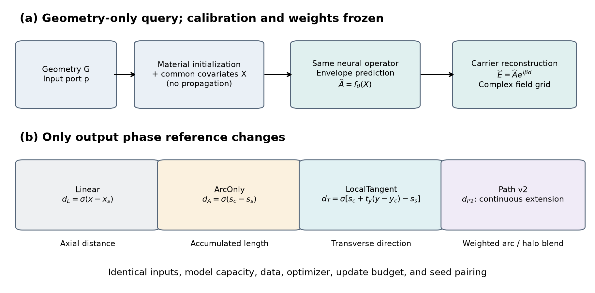
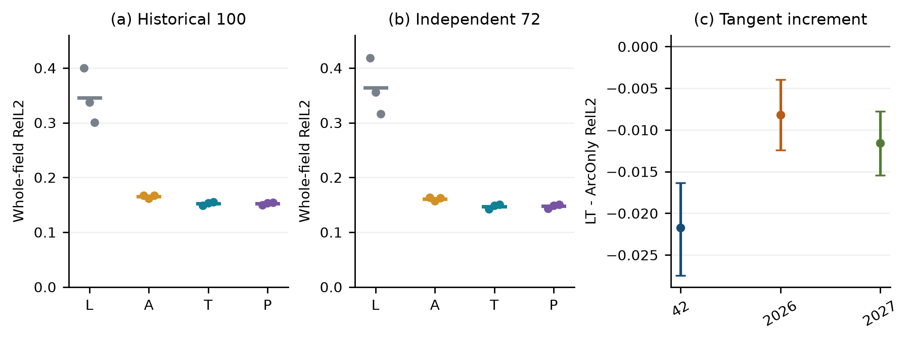
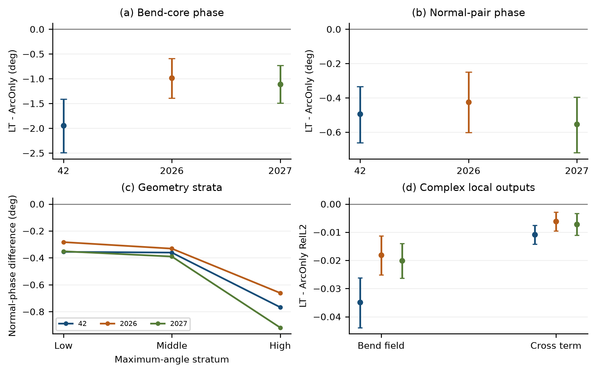
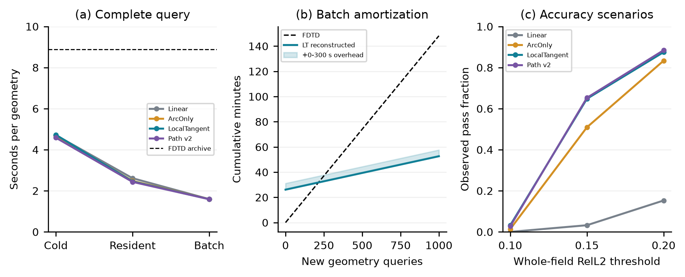

# Neural-operator prediction of complex electric fields in S-bend waveguides using geometry-derived phase references

::: {.author-block}
**Hengyi Ji**

University of Science and Technology of China, Hefei, China

Corresponding author: [jihy2241@mail.ustc.edu.cn](mailto:jihy2241@mail.ustc.edu.cn)
:::

## Abstract

Neural-operator prediction of complex optical fields is challenged by rapidly varying phase. Hence, we instead predict a residual complex envelope after removing a geometry-derived reference phase from finite-difference time-domain (FDTD) fields, then reconstruct the field. With identical architectures, inputs, and training budgets, an arc-length reference reduces full-field relative L2 error from 0.3636 to 0.1610 across 72 Euler S-bends and three training seeds. A local-tangent correction further reduces error to 0.1472 and bend-core phase error from 5.534° to 4.188°. Its advantage persists on 36 sinusoidal S-bends without retraining. Prediction takes 1.591 s per structure versus 8.892 s for FDTD.

## 1. Introduction

By learning solution mappings across parameter settings, neural operators offer a route to rapid electromagnetic-field prediction for photonic devices [1]. In integrated photonics, NeurOLight combines factorized Fourier networks with wave priors to predict frequency-domain electric fields in parameterized photonic devices [2]. PACE investigates field prediction for complex devices through architectural improvements and staged prediction strategies [3], whereas PIC-Flow uses conditional flow matching to predict full fields in silicon photonic devices [4]. In addition to network architecture, wave priors, and learning strategies, the output representation of the complex electric field is a design choice. For waveguides with a well-defined propagation path, we ask whether known geometry can reduce the burden of learning rapid field-phase oscillations directly.

Separating a rapidly oscillating phase factor from a complex-amplitude envelope is an established idea in numerical wave modeling. For example, COMSOL's beam-envelope treatment of an S-bend waveguide constructs a reference phase from the propagation-path length [5]. Related ideas have also been used in neural-network approximations and reduced-order models for high-frequency wave problems [6,7]. Guided-mode theory and equivalent models of bent waveguides provide a basis for describing phase accumulation and local propagation direction [8,9]. For neural operators, these ideas can inform both input features and learning targets. A geometry-derived reference phase need not describe the entire electromagnetic field in a bent waveguide; its purpose is to extract the phase component that can be described from geometry.

We study S-bend waveguides at a fixed wavelength in a two-dimensional effective-index model. Reference phases are constructed progressively from cumulative centerline arc length and local tangent direction. The neural operator learns the complex-amplitude envelope remaining after removal of the reference phase, and the complex electric field is reconstructed afterward. By keeping the network architecture, input information, and training budget identical, we examine the contribution of the arc-length reference, the additional contribution of a local-tangent correction, and the performance of a more elaborate reference construction.

The experiments focus on Euler S-bends. Retrospective comparisons are separated from independent testing performed after the methods and model checkpoints were fixed, and three training seeds are used to evaluate the different reference phases. The models are then applied directly to sinusoidal S-bends, and local phase results are compared across FDTD reference grids to examine the scope of the observed differences. Finally, a prediction pipeline requiring only geometry and excitation information, together with complete workflow timing, is used to assess when the method is useful for repeated field calculations.

## 2. Geometry-based output phase representations

### 2.1 Complex-field decomposition and learning target

A reference phase is first constructed from the waveguide geometry and excitation port. Removing this phase from the original complex field yields the complex-amplitude envelope used as the neural operator's learning target. The same reference phase is used to reconstruct the field after prediction.

Let $E=E_z(\mathbf r;\mathcal G,p)$ denote the frequency-domain field determined by geometry and materials $\mathcal G$, input port $p$, and position $\mathbf r=(x,y)$. Define

$$
A=Ee^{-i\phi},\qquad
\widehat E=f_\theta(X(\mathcal G,p))e^{i\phi},\qquad
\phi(\mathbf r;\mathcal G,p)=\beta(\mathcal G)d(\mathbf r;\mathcal G,p).
$$

Here, $X$ is the model input tensor, $f_\theta$ is the neural operator, $d$ is a geometry-derived propagation-distance reference, and $\beta$ is the propagation constant. The predicted envelope is $\widehat A=f_\theta(X)$, and the phase carrier is $e^{i\phi}$. The carrier depends on the geometry and port of the queried structure, whereas its construction rules and the calibration parameters determined from training data remain fixed during testing. All methods use the same input tensor, including the same four geometric distance features.

Because the phase carrier has unit modulus, the error norms before and after reconstruction satisfy

$$
\|\widehat E-E\|_2=\|\widehat A-A\|_2,\qquad
\|E\|_2=\|A\|_2.
$$

The relative loss is therefore invariant under reconstruction. However, for separately trained networks of finite capacity, different reference phases produce different envelopes to be learned. Wherever $E=\rho e^{i\theta}$ is nonzero and differentiable,

$$
|\nabla A|^2=|\nabla\rho|^2+\rho^2|\nabla\theta-\nabla\phi|^2.
$$

This relation shows that removing a predictable phase component can change the spatial variation of the envelope. At field zeros, the product-rule identity $\nabla A=e^{-i\phi}(\nabla E-iE\nabla\phi)$ is more appropriate. A reference phase does not guarantee a smoother envelope throughout the computational domain; counterexamples and discussion are provided in Supplement 1.

### 2.2 Linear, arc-length, and local-tangent references

We first construct three propagation-distance references that progressively incorporate geometric information. The simulation uses a 256-point Euler centerline, with the waveguide represented by overlapping rotated rectangular blocks and straight leads. For a polyline that is monotone in $x$, let $y_c(x)$ be its centerline height, $s_c(x)$ its interpolated cumulative arc length, $s_s$ the arc coordinate of the projected source position, and $t_y(x)$ the vertical component of the unit tangent obtained from the centerline slope. The source's axial coordinate is $x_s$. We set $\sigma=+1$ for excitation from the left and $\sigma=-1$ for excitation from the right. The three distance references are

$$
\begin{aligned}
d_L(x,y)&=\sigma(x-x_s),\\
d_A(x,y)&=\sigma[s_c(x)-s_s],\\
d_T(x,y)&=\sigma\{s_c(x)+t_y(x)[y-y_c(x)]-s_s\}.
\end{aligned}
$$

Linear uses axial distance as the reference. Because propagation along a bent centerline generally follows a longer path than the corresponding axial distance, ArcOnly replaces axial distance with cumulative centerline arc length to describe bend-induced phase accumulation. Its reference phase, however, does not vary with $y$ at a given $x$. LocalTangent adds a transverse correction associated with the local tangent direction to the arc-length reference, describing local wavefront variation when the propagation direction deviates from the $x$ axis.

### 2.3 Extended reference construction

To examine a more elaborate spatial reference, we also compare Path v2. This method combines a Gaussian-weighted average of centerline arc coordinates with a local-tangent correction and introduces continuous transitions around the waveguide and in the outer region. Letting $z=y-y_c(x)$, the implementation takes the form

$$
d_{P2}=\sigma\left[s_c+g\{B(q-s_c)+(1-B)t_yz\}-s_s\right].
$$

Here, $g$ activates the bend interval, and $B$ transitions from 1 near the waveguide to 0 outside a prescribed outer region. The kernel width is $0.05\,\mu\mathrm m$. The transverse transition starts at $w/2+0.05\,\mu\mathrm m$ and spans $0.5\,\mu\mathrm m$, where $w$ is the waveguide width, using fixed quintic polynomial gates. The implemented reference is continuous, but global $C^2$ regularity has not been established.

These construction parameters were determined on 16 separate development samples that were excluded from subsequent model training, validation, and testing. Details of the Gaussian-weighted construction and its comparison with the earlier nearest-point projection method are given in Supplement 1.

### 2.4 Propagation-constant calibration and common model inputs

In the two-dimensional effective-index model used here, the effective core index varies with waveguide width, resulting in different propagation constants. Using the existing 64 FDTD training samples, five axial sampling lines at different transverse positions are selected in each sample's downstream straight segment to extract the rate of field-phase variation along the propagation direction. After harmonizing the signs for left and right excitation, a linear fit of the phase slope against the core permittivity gives

$$
\beta(\varepsilon_{\max})=1.1047227348\varepsilon_{\max}+2.5607120654
\quad \mathrm{rad}/\mu\mathrm m.
$$

Here, $\varepsilon_{\max}$ is the relative core permittivity, and the relative fitting residual is 0.2085%. This relation allows the propagation constant to be estimated directly from a new waveguide's material parameters without solving its mode again.

The network receives 12 real-valued features: normalized permittivity, source mask, spatial coordinates, source position, excitation direction, fitted propagation constant, and four geometric propagation-distance features (Path v1, Linear, LocalTangent, and Path v2). Path v1 uses nearest-point projection. These features are packed into seven complex input channels before the wave prior is introduced.

All four models use identical input features, propagation-constant calibration, and amplitude normalization determined from the training data. They differ only in their output reference phase and corresponding learning target. Calibration parameters remain fixed during subsequent testing and grid-resolution comparisons. Figure 1 summarizes the complete prediction pipeline. Every model computes the common geometric features, and this preprocessing is therefore included in the computational-cost analysis.

**Figure 1. Geometry-based complex-field prediction pipeline and output phase references.** Meep initializes only the material grid, without time-domain propagation. All methods use the same material, source, coordinate, and geometric features. The neural operator predicts a complex-amplitude envelope, which is multiplied by the phase carrier to reconstruct $E_z$. The reference phase is determined by geometry and excitation and does not depend on the queried structure's FDTD ground truth.

## 3. Simulation and evaluation protocol

### 3.1 FDTD simulation and prediction target

The prediction target is the steady-state frequency-domain $E_z$ component of a two-dimensional effective-index waveguide model at $\lambda=1.55\,\mu\mathrm m$. The cladding refractive index is 1.444, and the original width-dependent effective-index table is used for the core. Fields are generated with Meep 1.35.1 [10]. Table 1 summarizes the computational domain and spatial sampling; Meep's subpixel smoothing and PML boundary treatments are described in Refs. [11,12].

| Simulation parameter | Setting |
| -------------------- | ------- |
| Computational domain | $26\times10\,\mu\mathrm m$ |
| Perfectly matched layer (PML) thickness | $1\,\mu\mathrm m$ |
| Baseline resolution | 20 pixels/μm |
| Exported region, excluding PML | $24\times8\,\mu\mathrm m$ |
| Number of sampling points | $160\times480$ |
| Sampling interval | $0.05\,\mu\mathrm m$ |

**Table 1. FDTD spatial discretization and computational domain.**

Excitation uses a fixed Gaussian eigenmode pulse. The source planes are at $x=\pm11.9\,\mu\mathrm m$, and the modal reference planes are at $x=\pm11.5\,\mu\mathrm m$. Source and port heights are determined by waveguide geometry. Phase comparisons retain the original source and discrete Fourier transform (DFT) phase convention.

### 3.2 Datasets and independent-test design

The original Euler dataset contains 64 training, 16 validation, and 100 original test structures, with one excitation direction assigned to each structure. The respective left/right excitation counts are 32/32, 8/8, and 50/50. Waveguide width takes eight values from $0.400$ to $0.575\,\mu\mathrm m$. The offset lies in $[2.0,5.5]\,\mu\mathrm m$, and the radius parameter of the geometry constructor lies in $[3.0,7.0]\,\mu\mathrm m$, both on a $0.025\,\mu\mathrm m$ lattice and subject to geometric fitting constraints.

The original 100 test structures are used for retrospective comparison: the comparison protocol was refined and additional training seeds were introduced after preliminary evaluation results became available. To test whether the improvement reproduces on new structures, a separate independent test set of 72 Euler waveguides was constructed after the four reference-phase constructions and all 12 model checkpoints had been fixed.

The independent set is stratified by maximum centerline inclination. A total of 6000 candidate structures are generated within the original geometric parameter ranges and divided into low-, medium-, and high-angle strata using boundaries of 32.0625° and 37.8138°. Each stratum contains 24 structures, with three samples per width and 12 excitations from each side. Selection excludes structures already present in existing records, requires a centerline root-mean-square distance of at least $0.035\,\mu\mathrm m$ between structures of the same width, and checks for duplicate discretized material grids. This test set covers the original parameter range, but its angle-stratified sampling distribution differs from that of the original test set.

A further 36 sinusoidal S-bends are constructed to examine the effect of centerline shape. Their continuous centerline is

$$
x=L(u-1/2),\qquad y=l\left[u-\frac{\sin(2\pi u)}{2\pi}-\frac12\right],\qquad 0\le u\le1.
$$

Here, $L$ is the axial span of the bend and $l$ is the endpoint offset. Both slope and curvature vanish at the endpoints. The simulation uses the same 256-point overlapping-block construction as for the Euler waveguides. Sinusoidal test structures are matched to selected Euler structures in endpoint span, offset, waveguide width, and excitation direction, covering three maximum-inclination strata, six widths, and both excitation directions. The two families have similar overall dimensions but different arc-length and curvature distributions. All 12 trained models are applied directly, and their predictions are fixed before the new FDTD fields are generated.

Subsequent timing analysis and field visualizations use the independent set of 72 structures. Grid comparisons and phase-origin diagnostics use the subsets and controls listed in Table 2. Model weights, checkpoints, calibration parameters, and reference-phase constructions remain fixed throughout independent evaluation and subsequent tests, without retraining, model selection, or parameter tuning.

| Dataset or evaluation | Structures | Purpose |
| --------------------- | ---------: | ------- |
| Training / validation | 64 / 16 | Learning data at the original resolution of 20 |
| Original test set | 100 | Retrospective evaluation; one direction per structure |
| Independent test set | 72 | 24 structures per maximum-inclination stratum |
| First grid subset | 18 | Resolutions 20, 30, and 40 |
| Phase-origin diagnostics | 9 | Up to resolution 60; straight-waveguide controls |
| Higher-resolution controls | 3 | Resolution 80; both directions represented |
| Sinusoidal test set | 36 | Frozen Euler-trained models; no retraining |
| Sinusoidal grid subset | 6 | Resolutions 20, 30, and 40 |

**Table 2. Datasets and numerical diagnostics.** Each structure has one assigned excitation direction unless specified otherwise for a diagnostic control. The Euler grid subsets overlap the independent set of 72 structures, and the six sinusoidal grid samples belong to the sinusoidal set of 36 structures. Neither grid subset is counted as an additional independent test set.

### 3.3 Neural-operator architecture and training configuration

All four reference methods use the same neural-operator architecture, adapted from the Fourier neural operator in NeurOLight [2]. The network consists of a convolutional input stem, 12 blocks of width 64, and a prediction head with 256 hidden units. Fourier modes are set to 40/70. The network includes feed-forward and depthwise computation modules, uses GELU activation and dropout probability 0.1, and retains NeurOLight's exponential wave prior. Each model has 1,593,122 parameter elements, some of which are complex. Counting the real and imaginary components of complex parameters separately gives 2,944,802 real scalar parameters.

Training uses AdamW for 2400 updates with batch size 2, initial learning rate 0.002, weight decay $10^{-4}$, and gradient clipping at 5. The learning rate follows a cosine schedule to $10^{-4}$. FP32 with TF32 enabled and a common amplitude normalization scale are used. The loss is the mean squared relative complex-field error across samples.

Each method is trained with seeds 42, 2026, and 2027. Within each seed, all methods share the same parameter initialization and training-batch order. The best checkpoint is selected by validation RelL2. Sensitivity to using the final training checkpoint is reported in Supplement 1.

### 3.4 Evaluation metrics and statistics

Complex-field prediction accuracy over the full field and local regions is measured by relative L2 error (RelL2). For each waveguide and evaluation region $\Omega$,

$$
r_\Omega=\left(\frac{\sum_{\mathbf r\in\Omega}|\widehat E-E|^2}{\sum_{\mathbf r\in\Omega}|E|^2}\right)^{1/2}.
$$

The bend-core region comprises points within $w/2$ of the centerline and within the bend's axial interval. RelL2 is calculated over the complete evaluation region without an amplitude threshold.

The source-referenced phase error is $\delta=\operatorname{Arg}(\widehat E E^*)$. Its intensity-weighted mean absolute error (WMAE) is

$$
e_\phi=\frac{\sum_{\mathbf r\in\Omega_g}|E|^2|\delta|}{\sum_{\mathbf r\in\Omega_g}|E|^2}.
$$

Here, $\Omega_g$ contains only bend-core points whose ground-truth amplitude is at least 5% of the peak amplitude in that region. A fixed worst-case phase error is assigned when a near-zero prediction makes its phase undefined. Phase metrics are reported in degrees.

To examine transverse coherence under single-port excitation, complex bilinear interpolation is used to sample normal pairs $\mathbf r_\pm=\mathbf r_c\pm(w/4)\mathbf n$. Define the complex cross terms $C=E_+E_-^*$ and $\widehat C=\widehat E_+\widehat E_-^*$. The mean of $|\operatorname{Arg}(\widehat C C^*)|$, weighted by $|C|$, measures the normal-pair relative-phase error. Cross-term RelL2 directly compares $C$ and $\widehat C$.

All errors are computed directly from reconstructed complex fields, without phase correction or amplitude scaling fitted to test ground truth. For independent testing, errors are first computed for each waveguide and then averaged equally over the 72 structures. We report the mean of these sample-mean errors across three seeds and their sample standard deviation across seeds.

Differences between methods are assessed using paired error differences for the same geometry. For each pair of fixed trained models, 95% bootstrap confidence intervals for the mean paired difference are estimated by 10,000 resamplings of the 72 structures with replacement.

## 4. Prediction results

### 4.1 Full-field performance of different phase references

Both retrospective and independent tests show that the arc-length reference accounts for the main improvement in full-field error, with the local-tangent correction providing a further reduction. On the original 100 structures, the three-seed mean full-field RelL2 values for Linear, ArcOnly, LocalTangent, and Path v2 are 0.3459, 0.1652, 0.1524, and 0.1524, respectively.

On the independent set of 72 structures, ArcOnly reduces mean full-field RelL2 from 0.3636 to 0.1610. LocalTangent further reduces it to 0.1472, an 8.59% reduction relative to ArcOnly (Table 3 and Figure 2). The improvement occurs for all three seeds, with every paired confidence interval below zero (Figure 2c and Table 4).

The extended Path v2 construction gives a full-field RelL2 of 0.1474, close to LocalTangent, and the sign of their difference varies across seeds. Under the examined initializations, the more complex reference therefore offers no consistent full-field advantage.

| Reference | Full-field RelL2 | Bend RelL2 | Bend phase (°) | Normal-pair phase (°) |
| --------- | ---------------: | ---------: | -------------: | --------------------: |
| Linear | 0.3636 ± 0.0515 | 0.2801 ± 0.0351 | 12.4333 ± 1.3510 | 6.2427 ± 0.6475 |
| ArcOnly | 0.1610 ± 0.0034 | 0.1257 ± 0.0046 | 5.5342 ± 0.2736 | 3.9901 ± 0.0500 |
| LocalTangent | 0.1472 ± 0.0045 | 0.1013 ± 0.0057 | 4.1876 ± 0.3143 | 3.4990 ± 0.0151 |
| Path v2 | 0.1474 ± 0.0039 | 0.1012 ± 0.0051 | 4.1556 ± 0.3167 | 3.4724 ± 0.0392 |

**Table 3. Results on 72 independent Euler waveguides.** Values are the mean ± sample standard deviation across the three seed-specific sample-mean errors. Complete seed statistics, medians, distribution tails, cross terms, and paired intervals are provided in Supplement 1.

**Figure 2. Full-field performance of different phase references.** (a) Retrospective comparison on the original 100 structures. (b) Independent testing on 72 structures stratified by maximum inclination. Dots indicate sample-mean errors for individual seeds; short horizontal lines indicate their three-seed means. (c) Paired error differences, LocalTangent minus ArcOnly, and 95% bootstrap confidence intervals on the independent set. Negative values indicate lower LocalTangent error.

### 4.2 Local phase prediction and geometric dependence

Full-field RelL2 characterizes overall field accuracy. To examine the local-tangent correction specifically in the bend, we additionally compare bend-core errors, normal-pair relative phase, and transverse complex cross terms.

Relative to ArcOnly, LocalTangent reduces bend-core RelL2 from 0.1257 to 0.1013, bend-core phase WMAE from 5.534° to 4.188°, and normal-pair relative-phase WMAE from 3.990° to 3.499° (Table 3). Both phase metrics have negative paired differences for all three seeds, and all six corresponding confidence intervals lie below zero (Figure 3a,b).

| Seed | Full-field RelL2 difference | 95% bootstrap CI | Structures with lower full-field error (of 72) | Bend-core phase WMAE difference (°) | Normal-pair phase WMAE difference (°) |
| ---- | -------------------------: | ---------------- | --------------------------------------------: | ---------------------------------: | -----------------------------------: |
| 42 | −0.02173 | [−0.02746, −0.01634] | 63 | −1.946 | −0.495 |
| 2026 | −0.00819 | [−0.01244, −0.00398] | 57 | −0.985 | −0.425 |
| 2027 | −0.01158 | [−0.01547, −0.00775] | 55 | −1.108 | −0.553 |

**Table 4. Seed-specific paired comparisons on the independent set.** All differences are LocalTangent minus ArcOnly; negative values indicate lower LocalTangent error. Paired confidence intervals for the two phase metrics are shown in Figure 3.

Transverse complex cross-term RelL2 also decreases, from 0.1081 to 0.1001, with negative paired confidence intervals for all three seeds. When grouped by maximum centerline inclination, the reductions in normal-pair relative-phase error in the high-angle stratum are approximately 0.77°, 0.66°, and 0.92°, compared with 0.36°, 0.28°, and 0.35° in the low-angle stratum. This trend is consistent with the role of transverse propagation direction.

**Figure 3. Local wavefront prediction on the independent set.** (a,b) Seed-specific paired differences and confidence intervals for bend-core phase and normal-pair relative-phase error. (c) Normal-pair relative-phase differences stratified by maximum centerline inclination, with 24 structures per stratum. (d) Differences in bend-core complex-field and transverse cross-term errors across the three seeds. Negative values indicate lower LocalTangent error than ArcOnly.

### 4.3 Prediction on sinusoidal S-bends

When the Euler-trained models are applied directly to 36 sinusoidal waveguides, the full-field performance relationship between arc-length and local-tangent references persists (Table 5). Relative to ArcOnly, LocalTangent reduces full-field RelL2 from 0.1579 to 0.1426 and bend-core RelL2 from 0.1229 to 0.0977. Bend-core phase WMAE decreases from 5.332° to 3.899°, normal-pair relative-phase WMAE from 4.399° to 3.785°, and transverse cross-term RelL2 from 0.1155 to 0.1068.

For all three seeds, the 95% bootstrap confidence intervals for the paired differences, LocalTangent minus ArcOnly, lie below zero for both phase metrics. Thus, the phase-prediction improvement of the local-tangent reference over the arc-length reference remains observable in the second family of smooth, single-path centerlines examined here.

| Reference | Full-field RelL2 | Bend RelL2 | Bend phase (°) | Normal-pair phase (°) |
| --------- | ---------------: | ---------: | -------------: | --------------------: |
| Linear | 0.3201 | 0.2476 | 10.5367 | 5.7063 |
| ArcOnly | 0.1579 | 0.1229 | 5.3322 | 4.3993 |
| LocalTangent | 0.1426 | 0.0977 | 3.8985 | 3.7851 |
| Path v2 | 0.1426 | 0.0975 | 3.8580 | 3.7555 |

**Table 5. Euler-trained models evaluated on 36 sinusoidal waveguides.** Values are the means of the three seed-specific sample-mean errors.

### 4.4 Phase comparisons across FDTD reference grids

To examine whether the normal-pair relative-phase advantage depends on the FDTD reference grid, grid-resolution comparisons are performed on matched geometries. The relevant subsets and diagnostic controls are listed in Table 2.

The local-tangent reference retains its advantage over the arc-length reference in mean normal-pair phase error across the FDTD reference grids examined. In particular, for the six preselected sinusoidal waveguides, LocalTangent has lower mean normal-pair relative-phase error than ArcOnly at resolutions 20, 30, and 40. Complete matched-grid phase comparisons, unfavorable results, and reference-field diagnostics are provided in Supplement 1.

### 4.5 Optical postprocessing of predicted fields

Beyond direct complex-field errors, transmission-phase extraction is examined on the original 100 waveguides. With a fixed directional extractor, the transmission-phase mean absolute errors for Linear, ArcOnly, LocalTangent, and Path v2 are 28.66°, 8.50°, 7.36°, and 7.41°, respectively. Applying the same extractor to the FDTD ground-truth electric fields gives a transmission-phase difference of 0.027° relative to native modal coefficients from Meep mode decomposition [13].

This agreement indicates consistency between the extractor and the original modal analysis and supports using the predicted complex fields to estimate transmission phase. Power-related metrics, however, do not improve consistently, and extraction of weak reflections remains limited. Complete postprocessing results are given in Supplement 1.

### 4.6 Exploratory comparison for a different device topology

In an exploratory Y-branch comparison, Branch Path yields RelL2 values of 0.5333 and 0.4960 on two test sets of 100 geometries each. Adding a tangent correction, BranchTangent, increases these values to 0.5494 and 0.5111. This experiment uses only one training seed and a reference construction based on path routing and hard assignment. The local-tangent correction does not improve prediction under this setting; the complete experiment is reported in Supplement 1.

## 5. Prediction workflow and computational cost

### 5.1 Geometry-based prediction pipeline

Following the pipeline in Figure 1, the trained model generates the material grid, source information, common input features, and reference phase using only waveguide geometry and excitation port. Neither FDTD time-domain propagation nor access to the queried structure's ground-truth electric field is required.

For all 72 independent test structures, this pipeline generates material distributions, source information, input features, and reference phases identical to those of the original evaluation pipeline. Predictions from all 12 models are also reproduced bit for bit. This confirms that the trained models can independently predict complex fields for new structures.

### 5.2 Complete workflow timing

Timing covers the complete workflow from geometric parameters to complex-field output, rather than only comparing network inference with FDTD propagation. Surrogate timing includes material initialization, common geometric-feature and reference-phase computation, input compression and reading, data transfer, field reconstruction, and output export. Process-startup overhead is estimated through cold-start tests and included in the corresponding workflow. Model loading and warm-up are recorded separately and treated as session overhead in cumulative-cost analysis.

Experiments run under WSL Ubuntu 24.04 on an Intel Core Ultra 7 356H processor and an NVIDIA RTX 5070 Laptop GPU with approximately 12 GB of GPU memory. FDTD uses the original two-thread CPU configuration. The surrogate runs GPU inference with PyTorch 2.11.0 and CUDA 12.8, using four Torch threads. GPU operations are synchronized during timing.

Timing uses the seed-2026 models and covers three usage scenarios:

- **Cold-start single query:** one specified waveguide is evaluated in a fresh process, with three repeated measurements.
- **Resident-model single query:** the model is preloaded on the GPU, and left- and right-excited structures selected from each of the three inclination strata are tested.
- **Batch queries:** all 72 independent structures are evaluated with batch sizes 1 and 2. Inference and output export are timed three times, including the full geometry-preprocessing cost.

The original FDTD workflow takes 8.892 s per structure on average. For LocalTangent, the mean times for cold-start, resident-model, and 72-structure batch prediction are 4.725, 2.454, and 1.591 s per structure, corresponding to FDTD-to-surrogate time ratios of 1.88, 3.62, and 5.59.

Within the prediction workflow, common geometric-feature computation takes 1.142 s on average, material initialization takes 0.222 s, and input export takes 0.126 s. Overall times differ little among the four reference methods. The main cost is common geometric-feature computation rather than differences among reference-phase formulas, making geometry preprocessing the primary target for further optimization.

### 5.3 Offline investment and cumulative-time break-even

The surrogate requires training-data generation and model training in advance. Table 6 summarizes the offline cost for one trained LocalTangent model.

| Offline cost item | Time (s) |
| ----------------- | -------: |
| Training-data generation | 798.36 |
| Common geometric-feature computation | 97.88 |
| Network training | 650.23 |
| Previously untimed preparation, supplementary estimate | 19.71 |
| Total | 1566.18 |

**Table 6. Offline computational cost for one LocalTangent model.**

The supplementary preparation estimate includes propagation-constant calibration, data assembly, run setup, and cache operations, estimated by reproducing the corresponding operations in the current environment. The total offline investment is approximately 26.10 min. Detailed timing boundaries and sensitivity to additional overhead are provided in Supplement 1.

For predictions on $N$ new waveguides, the cumulative costs of the surrogate and the original FDTD workflow are

$$
C_{\mathrm{sur}}(N)=C_{\mathrm{offline}}+C_{\mathrm{session}}+Nt_{\mathrm{query}},\qquad
C_{\mathrm{FDTD}}(N)=Nt_{\mathrm{FDTD}}.
$$

Here, $C_{\mathrm{offline}}$ is the initial model-development cost, $C_{\mathrm{session}}$ is session overhead such as model loading and warm-up, and $t_{\mathrm{query}}$ and $t_{\mathrm{FDTD}}$ are the per-query times of the surrogate and original FDTD workflows.

When $t_{\mathrm{FDTD}}>t_{\mathrm{query}}$, the integer break-even query count is

$$
\left\lceil\frac{C_{\mathrm{offline}}+C_{\mathrm{session}}}{t_{\mathrm{FDTD}}-t_{\mathrm{query}}}\right\rceil.
$$

Using the measured and supplementary estimated costs, the expected break-even points are 376 queries for cold-start single queries and 244 for resident-model single queries. The estimated batch break-even point is 215 queries, or 216 if complete batches of 72 structures are executed (Table 7 and Figure 4).

| Query mode | Time per geometry (s) | FDTD-to-surrogate time ratio | Break-even queries |
| ---------- | --------------------: | --------------------------: | -----------------: |
| Cold-start single query | 4.725 | 1.88 | 376 |
| Resident-model single query | 2.454 | 3.62 | 244 |
| Batch, 72 queries | 1.591 | 5.59 | 216 |

**Table 7. LocalTangent workflow timing and time break-even on the specified hardware.** The seed-2026 model is used. Batch timing is the mean per-structure time for the complete workflow over 72 structures. Break-even counts use approximately 26.10 min of offline cost, combining historical measurements and supplementary estimates, together with the corresponding session costs.

### 5.4 Computational efficiency and prediction-error requirements

Time-cost comparisons must be interpreted alongside application-specific error requirements. Figure 4c shows empirical pass rates at illustrative full-field RelL2 thresholds on the independent set. Each seed's pass rate is calculated on the same 72 structures and then averaged across the three seeds. This metric describes observed prediction performance under a specified error requirement; it does not interpret the surrogate's time ratio as acceleration between solvers of equal accuracy.

**Figure 4. Computational cost and empirical prediction accuracy.** (a) Complete query costs for cold-start, resident-model, and batch prediction; the dashed line indicates the original FDTD workflow. (b) Cumulative LocalTangent batch cost based on measured and supplementary estimated offline investment, with a sensitivity band for additional overhead. (c) Observed fractions satisfying illustrative full-field RelL2 thresholds, averaged across the three seeds on the same 72 structures.

## 6. Discussion

### 6.1 Role and interpretive limits of the reference phase

The comparisons indicate that cumulative centerline arc length and local propagation direction serve different roles in the output-field representation. The arc-length reference produces the main full-field error improvement, whereas the local-tangent correction further improves bend fields and transverse phase prediction. The larger reductions in normal-pair phase error in the high-angle stratum are consistent with the correction's incorporation of propagation direction. The more elaborate Path v2 reference, by contrast, provides no consistent full-field advantage.

A geometry-derived reference phase extracts the phase component describable from geometry, allowing the neural operator to learn the remaining complex-amplitude envelope. This representation does not guarantee removal of rapid oscillations throughout the computational domain. Fourier analysis in Supplement 1 shows that improved prediction cannot simply be attributed to a globally smoother envelope. The present comparisons are also limited to a fixed network architecture and training budget; relative performance under other architectures, training-data sizes, or longer training remains undetermined.

### 6.2 Scope across centerline shapes and device topologies

The sinusoidal-waveguide tests show that the local-tangent improvement persists in the second family of smooth, single-path centerlines examined here. The reference phase's effectiveness nevertheless depends on device topology and its construction.

The exploratory Y-branch comparison shows no improvement from the local-tangent correction (Section 4.6). Possible causes include ambiguity of propagation direction near branch junctions, transitions between path references, and transverse extrapolation, but the specific cause requires further investigation. Improvements on S-bends therefore cannot be directly generalized to devices with different topologies.

### 6.3 Optical postprocessing and practical use conditions

The different behavior of transmission-phase and power-related metrics indicates that downstream uses of predicted fields must be assessed against the error requirements of each task.

In terms of computational cost, the complete prediction workflow's time advantage is most relevant after model development, when many repeated queries are required and some prediction error is acceptable. The original FDTD and surrogate workflows use partly different hardware and produce partly different outputs. The reported time ratios therefore describe two practical workflows under specified conditions, rather than an inherent speedup between solvers of equal accuracy. Initial model-development investment, usage pattern, and error requirements jointly determine the practical computational benefit.

## 7. Conclusions

We compared geometry-derived reference phases for neural-operator prediction of complex fields in S-bend waveguides. With identical network architectures, input information, and training budgets, cumulative centerline arc length produces the main improvement in full-field error, and a local-tangent correction further improves complex-field and transverse-phase prediction in the bend. These improvements are observed on independent Euler waveguides and across training seeds. The advantage of the local-tangent reference over the arc-length reference also persists on sinusoidal waveguides without retraining.

The results show that geometric priors can be used both as network inputs and to reorganize the output field to be learned. For the S-bends studied here, reference phases based on the propagation path and local direction improve prediction of the specified FDTD complex fields without increasing the input information. They can reduce cumulative computation time when error requirements are met and sufficiently many repeated queries are performed. Applicability to other device topologies, physical conditions, and more accurate numerical references requires further study.

## Funding

No funding was received for this research.

## Disclosures

The author declares no conflicts of interest.

## AI-assisted language editing

The author used AI-assisted tools for language polishing and is responsible for the content of the manuscript.

## Data availability

Public Y-branch data and code are listed in Refs. [14,15]. The S-bend code, 12 trained checkpoints, geometry manifests, 288 primary-resolution field exports, geometry-level metric tables, and archived evaluation summaries are available in the accompanying repository at [github.com/Jacksonhy/geometry-phase-sbend](https://github.com/Jacksonhy/geometry-phase-sbend). The repository documents the scope of these exports; complete higher-resolution diagnostic fields and the full Y-branch raw data are not included.

## Supplementary material

Supplement 1 contains implementation and statistical details (Secs. S1–S2), independent-Euler statistics (Tables S1–S4), matched-grid comparisons and reference-field diagnostics (Tables S5–S13 and S19), workflow timing (Tables S14–S16), sinusoidal results (Tables S17–S19), retrospective and exploratory analyses (Tables S20–S23), and field and diagnostic visualizations (Figures S1–S7).

## References

1. Z. Li, N. Kovachki, K. Azizzadenesheli, B. Liu, K. Bhattacharya, A. Stuart, and A. Anandkumar, “Fourier neural operator for parametric partial differential equations,” *International Conference on Learning Representations* (2021).
2. J. Gu, Z. Gao, C. Feng, H. Zhu, R. T. Chen, D. S. Boning, and D. Z. Pan, “NeurOLight: A physics-agnostic neural operator enabling parametric photonic device simulation,” *Advances in Neural Information Processing Systems* (2022).
3. H. Zhu, W. Cong, G. Chen, S. Ning, R. T. Chen, J. Gu, and D. Z. Pan, “PACE: Pacing operator learning to accurate optical field simulation for complicated photonic devices,” *Advances in Neural Information Processing Systems* (2024).
4. J. Quaratiello and A. Rizzo, “Physics-based flow matching for full-field prediction of silicon photonic devices” (2026).
5. COMSOL AB, “Waveguide S-Bend” (n.d.).
6. W. Cai, X. Li, and L. Liu, “A phase shift deep neural network for high frequency approximation and wave problems,” *SIAM Journal on Scientific Computing* **42**, A3285–A3312 (2020).
7. V. Druskin, R. F. Remis, M. Zaslavsky, and J. T. Zimmerling, “Compressing large-scale wave propagation models via phase-preconditioned rational Krylov subspaces,” *Multiscale Modeling & Simulation* **16**, 1486–1518 (2018).
8. S. G. Johnson, P. Bienstman, M. A. Skorobogatiy, M. Ibanescu, E. Lidorikis, and J. D. Joannopoulos, “Adiabatic theorem and continuous coupled-mode theory for efficient taper transitions in photonic crystals,” *Physical Review E* **66**, 066608 (2002).
9. D. M. Shyroki, “Exact equivalent straight waveguide model for bent and twisted waveguides,” *IEEE Transactions on Microwave Theory and Techniques* **56**, 414–419 (2008).
10. A. F. Oskooi, D. Roundy, M. Ibanescu, P. Bermel, J. D. Joannopoulos, and S. G. Johnson, “Meep: A flexible free-software package for electromagnetic simulations by the FDTD method,” *Computer Physics Communications* **181**, 687–702 (2010).
11. Meep developers, “Subpixel Smoothing,” *Meep Documentation*, [https://meep.readthedocs.io/en/latest/Subpixel_Smoothing/](https://meep.readthedocs.io/en/latest/Subpixel_Smoothing/) (accessed 20 November 2026).
12. Meep developers, “Perfectly Matched Layer,” *Meep Documentation*, [https://meep.readthedocs.io/en/latest/Perfectly_Matched_Layer/](https://meep.readthedocs.io/en/latest/Perfectly_Matched_Layer/) (accessed 20 November 2026).
13. Meep developers, “Mode Decomposition,” *Meep Documentation*, [https://meep.readthedocs.io/en/latest/Mode_Decomposition/](https://meep.readthedocs.io/en/latest/Mode_Decomposition/) (accessed 20 November 2026).
14. Rizzo Integrated Photonic Systems Lab, “PIC-Flow Dataset” (2026).
15. Rizzo Integrated Photonic Systems Lab, “PIC-Flow: Source code” (2026).
