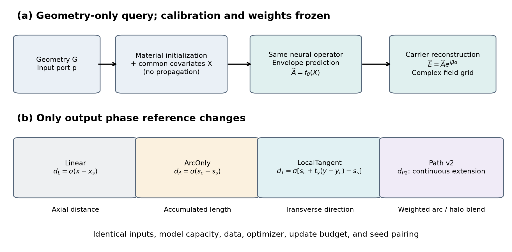
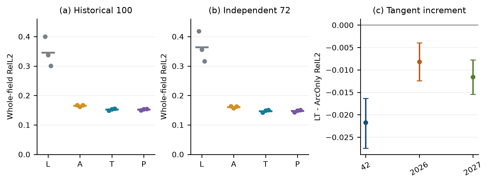
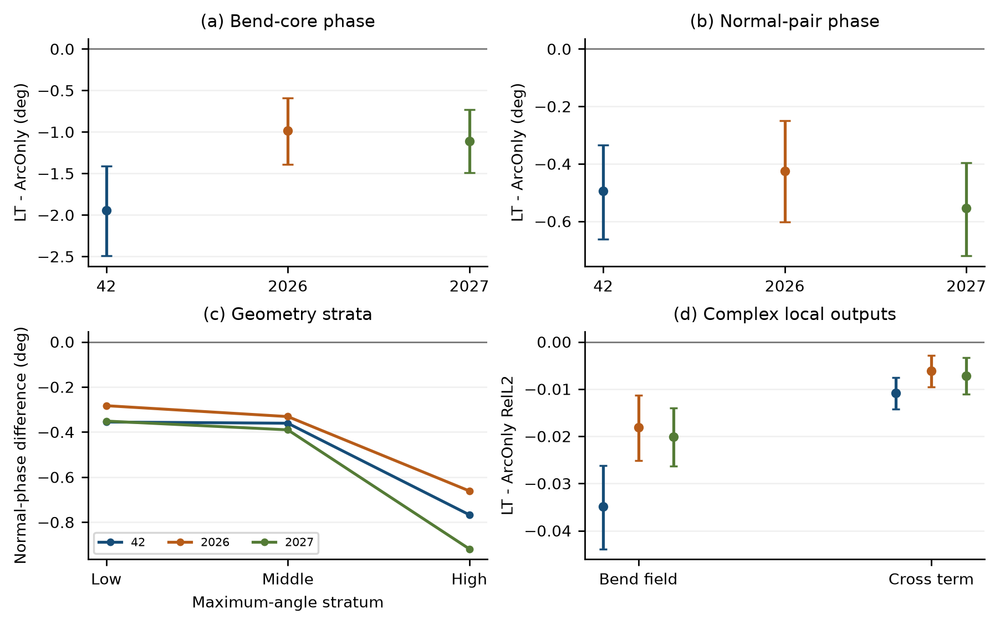
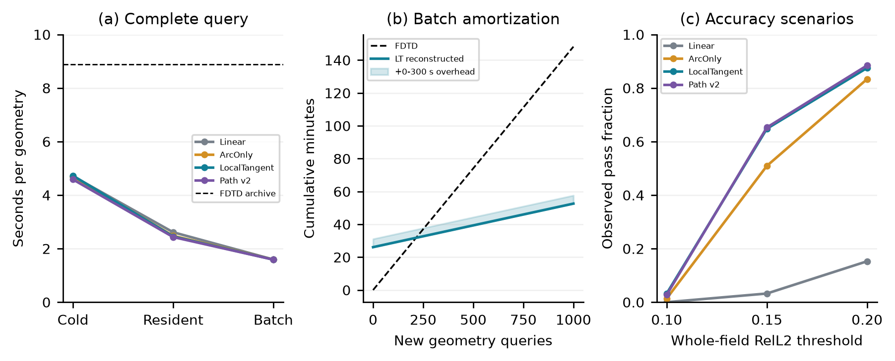

# 基于几何相位参考的 S 弯波导复电场神经算子预测

**版本 4.3。** 中文审阅稿；不包含作者元数据及声明。

## 摘要

Neural-operator prediction of complex optical fields is challenged by rapidly varying phase. Hence,we instead predict a residual complex envelope after removing a geometry-derived reference phase from finite-difference time-domain (FDTD) fields, then reconstruct the field. With identical architectures, inputs, and training budgets, an arc-length reference reduces full-field relative L2 error from 0.3636 to 0.1610 across 72 Euler S-bends and three training seeds. A local-tangent correction further reduces error to 0.1472 and bend-core phase error from 5.534° to 4.188°. Its advantage persists on 36 sinusoidal S-bends without retraining. Prediction takes 1.591 s per structure versus 8.892 s for FDTD.

## 1. 引言

神经算子通过学习不同参数条件下的解映射，为光子器件的快速电磁场预测提供了新的途径 [1]。在集成光子学领域，NeurOLight 将因子化傅里叶网络与波动先验相结合，实现了参数化光子器件的频域电场预测 [2]；PACE 通过改进神经算子架构和采用分阶段预测策略，研究复杂器件的电场预测问题 [3]；PIC-Flow 则利用条件流匹配方法预测硅光子器件的全场分布 [4]。除了网络架构、波动先验和学习策略，复电场的输出表示方式也是可以调整的设计因素。对于传播路径明确的波导，本文关注的问题是：能否利用已知几何信息，减少神经算子直接学习电场相位振荡的负担？

将快速振荡的相位因子与复振幅包络分离，是波动问题数值求解中的一种已有思路。例如，COMSOL 的 S 弯波导光束包络法利用传播路径长度构造参考相位 [5]；类似思想也用于高频波动问题的神经网络近似和降阶模型 [6,7]。导模理论及弯曲波导的等效模型则为描述相位积累和局部传播方向提供了依据 [8,9]。对于神经算子，这些思想不仅可以用于设计输入特征，也可以用于构造学习目标。几何参考相位无需完整描述弯曲波导中的电磁场，而是用于提取其中能够由几何信息描述的相位分量。

本文以二维有效折射率模型中固定波长下的 S 弯波导为研究对象，根据中心线累计弧长和局部切向方向逐级构造参考相位，使神经算子学习去除参考相位后的复振幅包络，并在预测完成后重建复电场。通过保持网络架构、输入信息和训练预算一致，分别考察弧长参考的作用、局部切向修正的附加作用以及更复杂参考构造的表现。

实验以欧拉型 S 弯波导为主，将回顾性比较与方法及模型检查点确定后的独立测试分开，并利用三个训练随机种子评估不同参考相位的预测性能。在此基础上，将模型直接应用于正弦型 S 弯波导，并比较不同 FDTD 参考网格下的局部相位结果，以考察上述性能差异的适用范围。最后，通过仅需几何及激励信息的预测流程和完整工作流程计时，分析该方法在重复电场计算中的应用条件。

## 2. 基于几何信息的输出相位表征

### 2.1 复电场分解与学习目标

本文首先依据波导几何与激励端口构造参考相位，再从原始复电场中去除该相位，得到作为神经算子学习目标的复振幅包络。预测完成后，利用同一参考相位重建复电场。

设 $E=E_z(\mathbf r;\mathcal G,p)$ 表示由几何结构及材料 $\mathcal G$、输入端口 $p$ 和位置 $\mathbf r=(x,y)$ 确定的频域场。定义

$$
A=Ee^{-i\phi},\qquad
\widehat E=f_\theta(X(\mathcal G,p))e^{i\phi},\qquad
\phi(\mathbf r;\mathcal G,p)=\beta(\mathcal G)d(\mathbf r;\mathcal G,p).
$$

其中，$X$ 为模型输入张量，$f_\theta$ 为神经算子，$d$ 为几何传播距离参考，$\beta$ 为传播常数。预测包络记为 $\widehat A=f_\theta(X)$，相位载波为 $e^{i\phi}$。载波随待预测结构的几何及端口而变化，但构造规则及基于训练数据确定的标定参数在测试中保持不变。所有方法使用相同的输入张量，包括相同的四种几何距离特征。

由于相位载波的模为 1，重建前后的误差范数满足

$$
\|\widehat E-E\|_2=\|\widehat A-A\|_2,\qquad
\|E\|_2=\|A\|_2.
$$

因此，相对损失在重建前后保持不变。然而，对于分别训练的有限容量网络，不同参考相位对应不同的待学习包络。在 $E=\rho e^{i\theta}$ 非零且可微的位置，有

$$
|\nabla A|^2=|\nabla\rho|^2+\rho^2|\nabla\theta-\nabla\phi|^2.
$$

该关系说明，去除可预测的相位分量能够改变包络的空间变化特征。在场的零点处，则更适合使用乘积求导恒等式 $\nabla A=e^{-i\phi}(\nabla E-iE\nabla\phi)$。参考相位并不保证包络在整个计算区域内更加平滑；补充材料 1 给出了反例和相应的讨论。

### 2.2 线性、弧长与局部切向参考

首先构造三个逐级引入几何信息的传播距离参考。仿真采用由 256 个点构成的欧拉中心线，并以相互重叠的旋转矩形块（Block）及直波导引线表示波导。对于在 $x$ 方向单调的折线，记中心线高度为 $y_c(x)$，插值得到的累计弧长为 $s_c(x)$，投影后的源位置坐标为 $s_s$，根据中心线斜率得到的单位切向量竖直分量为 $t_y(x)$。$x_s$ 为源的轴向坐标。左侧激励取 $\sigma=+1$，右侧激励取 $\sigma=-1$。三种距离参考定义如下：

$$
\begin{aligned}
d_L(x,y)&=\sigma(x-x_s),\\
d_A(x,y)&=\sigma[s_c(x)-s_s],\\
d_T(x,y)&=\sigma\{s_c(x)+t_y(x)[y-y_c(x)]-s_s\}.
\end{aligned}
$$

Linear（线性参考）以轴向距离为基准。由于弯曲波导沿中心线的传播路径通常长于对应的轴向距离，ArcOnly（弧长参考）以中心线累计弧长代替轴向距离，以描述弯曲引起的相位积累，但其参考相位在同一 $x$ 坐标处不随 $y$ 变化。LocalTangent（局部切向参考）在弧长参考的基础上引入与局部切向方向有关的横向修正，以描述传播方向偏离 $x$ 轴时的局部波前变化。

### 2.3 扩展参考构造

为考察更复杂的空间参考构造，本文还比较 Path v2。该方法将中心线弧长坐标的高斯加权平均与局部切向修正相结合，并在波导周围及外围区域设置连续过渡。令 $z=y-y_c(x)$，其实现形式为

$$
d_{P2}=\sigma\left[s_c+g\{B(q-s_c)+(1-B)t_yz\}-s_s\right].
$$

式中，$g$ 用于激活弯曲区间，$B$ 从波导附近的 1 过渡到预设外围区域之外的 0。核宽度为 $0.05\,\mu\mathrm m$；横向过渡从 $w/2+0.05\,\mu\mathrm m$ 开始，跨度为 $0.5\,\mu\mathrm m$，其中 $w$ 为波导宽度，采用固定的五次多项式门控函数。所实现的参考是连续的，但尚未证明具有全局 $C^2$ 性质。

上述构造参数在 16 个单独的开发样本上确定，这些样本不参与后续模型训练、验证或测试。高斯加权平均的具体构造及其与此前最近点投影方法的比较见补充材料 1。

### 2.4 传播常数标定与公共模型输入

在本文采用的二维有效折射率模型中，芯层有效折射率随波导宽度变化，因此不同宽度对应不同传播常数。利用已有的 64 个 FDTD 训练样本，在每个样本的下游直波导段内选取五条横向位置不同的轴向采样线，提取电场相位沿传播方向的变化率。统一左右激励的符号后，将相位斜率与芯层介电常数进行线性拟合，得到

$$
\beta(\varepsilon_{\max})=1.1047227348\varepsilon_{\max}+2.5607120654
\quad \mathrm{rad}/\mu\mathrm m.
$$

其中，$\varepsilon_{\max}$ 为芯层相对介电常数，拟合的相对残差为 0.2085%。该关系允许直接由新波导的材料参数估计传播常数，无需针对每个波导重新求解模式。

网络输入包含 12 个实值特征，涵盖归一化介电常数分布、源掩膜、空间坐标、光源位置、激励方向、拟合传播常数，以及四种几何传播距离特征（Path v1、Linear、LocalTangent 和 Path v2）。其中，Path v1 采用最近点投影方法。引入波动先验前，将这些特征组织为 7 个复值输入通道。

四种模型使用相同的输入特征、传播常数拟合关系及基于训练数据确定的振幅归一化尺度；区别仅在于输出参考相位及相应的学习目标。标定参数在后续测试及网格分辨率比较中保持不变。图 1 概括了完整预测流程。所有模型均需计算公共几何特征，因此计算成本分析也包含该预处理过程。

**图 1. 基于几何信息的复电场预测流程及输出相位参考。** Meep 仅初始化材料网格，不进行时域传播。各方法使用相同的材料、源、坐标及几何特征；神经算子预测复振幅包络，再乘以相位载波重建 $E_z$。参考相位由几何及激励决定，不依赖待预测结构的 FDTD 真值。

## 3. 仿真与评估方案

### 3.1 FDTD 仿真与预测目标

预测目标为二维有效折射率波导模型在波长 $\lambda=1.55\,\mu\mathrm m$ 下的稳态频域 $E_z$ 分量。包层折射率为 1.444，芯层采用原始的宽度相关有效折射率表。电场由 Meep 1.35.1 生成 [10]。

| 仿真参数              | 设置                       |
| --------------------- | -------------------------- |
| 计算区域              | $26\times10\,\mu\mathrm m$ |
| 完全匹配层（PML）厚度 | $1\,\mu\mathrm m$          |
| 基准分辨率            | 20 像素/μm                 |
| 导出区域（不含 PML）  | $24\times8\,\mu\mathrm m$  |
| 采样点数              | $160\times480$             |
| 采样间距              | $0.05\,\mu\mathrm m$       |

**表 1. FDTD 空间离散与计算区域设置。**

激励采用固定的高斯本征模脉冲，源平面位于 $x=\pm11.9\,\mu\mathrm m$，模式参考平面位于 $x=\pm11.5\,\mu\mathrm m$。源和端口的高度由波导几何决定；相位比较保留原始源及离散傅里叶变换（DFT）的相位约定。

### 3.2 数据集与独立测试设计

原始欧拉型波导数据集包括 64 个训练结构、16 个验证结构和 100 个原始测试结构，每个结构指定一个激励方向，左、右激励数量分别为 32/32、8/8 和 50/50。波导宽度在 $0.400$ 至 $0.575\,\mu\mathrm m$ 之间取 8 个值；偏移量在 $[2.0,5.5]\,\mu\mathrm m$ 内取值，几何构造器的半径参数在 $[3.0,7.0]\,\mu\mathrm m$ 内取值，两者均采用 $0.025\,\mu\mathrm m$ 的格点间隔，并满足几何适配条件。

原始 100 个测试结构用于回顾性比较：在获得初步评估结果后，比较方案得到完善，并增加了不同随机种子下的训练实验。为检验改善是否能在新结构上复现，本文在确定四种参考相位构造及全部 12 个模型检查点之后，另行构建 72 个欧拉型波导组成的独立测试集。

独立测试集按中心线最大倾角分层。从原始几何参数范围内生成 6000 个候选结构，根据 32.0625° 和 37.8138° 两个分界值划分低、中、高三个倾角区间。每层选取 24 个结构，每种波导宽度对应 3 个样本，左、右激励各 12 个。筛选时排除已有记录中的结构，要求同宽度结构之间的中心线均方根距离不小于 $0.035\,\mu\mathrm m$，并检查离散化材料网格是否重复。该测试集覆盖原始参数范围，但由于采用角度分层抽样，其样本分布与原始测试集并不完全相同。

为考察中心线形状变化的影响，另构建 36 个正弦型 S 弯波导。其连续中心线为

$$
x=L(u-1/2),\qquad y=l\left[u-\frac{\sin(2\pi u)}{2\pi}-\frac12\right],\qquad 0\le u\le1.
$$

其中，$L$ 为弯曲段的轴向跨度，$l$ 为端点偏移量。曲线的端点斜率和曲率均为零，仿真采用与欧拉型波导相同的 256 点重叠矩形块构造。正弦型测试结构与选定的欧拉型结构在端点跨度、偏移量、波导宽度及激励方向上匹配，涵盖三个最大倾角区间、六种波导宽度和两个激励方向。两类结构的主要尺寸相近，但弧长和曲率分布不同。全部 12 个已训练模型直接用于预测，且预测结果在生成新的 FDTD 场之前固定。

后续计算耗时分析及电场分布可视化以 72 个结构的独立测试集为基础。网格比较及相位来源诊断使用表 2 所列子集与对照结构。独立评估及后续测试均保持模型权重、检查点、标定参数和参考相位构造不变，不进行重新训练、模型选择或参数调整。

| 数据集或评估类型 | 几何结构数量 | 用途                           |
| ---------------- | ------------:| ------------------------------ |
| 训练／验证       | 64 / 16      | 原始分辨率 20 的学习数据       |
| 原始测试集       | 100          | 回顾性评估；每个结构一个方向   |
| 独立测试集       | 72           | 每个最大倾角分层 24 个         |
| 第一组网格子集   | 18           | 分辨率 20、30、40              |
| 相位来源诊断     | 9            | 最高分辨率 60；直波导对照      |
| 更高分辨率对照   | 3            | 分辨率 80；涵盖两个方向        |
| 正弦型测试集     | 36           | 冻结的欧拉训练模型；不重新训练 |
| 正弦型网格子集   | 6            | 分辨率 20、30、40              |

**表 2. 数据集及数值诊断的组成。** 除诊断对照另有说明外，每个结构指定一个激励方向。欧拉型网格子集与 72 个结构的独立测试集重叠；6 个正弦型网格样本属于 36 个结构的正弦型测试集。两种网格子集均不计为额外独立测试集。

### 3.3 神经算子架构与训练配置

四种参考方法采用相同的神经算子架构。网络基于 NeurOLight 的傅里叶神经算子进行改进 [2]，由卷积输入层、12 个宽度为 64 的网络模块以及具有 256 个隐藏单元的预测头组成。傅里叶模态数设置为 40/70，网络包含前馈和逐通道计算模块，采用 GELU 激活函数，Dropout 概率设为 0.1，并保留 NeurOLight 中指数形式的波动先验。各模型均包含 1,593,122 个参数元素，其中部分为复数参数。若将复数参数的实部和虚部分别计数，则模型共有 2,944,802 个实标量参数。

训练采用 AdamW 优化器，每次进行 2400 次参数更新，批量大小为 2，初始学习率为 0.002，权重衰减系数为 $10^{-4}$，梯度裁剪阈值为 5。学习率按余弦策略衰减至 $10^{-4}$。采用启用 TF32 的 FP32 精度及统一振幅归一化尺度，损失函数为各样本平方相对复电场误差的平均值。

每种方法分别使用 42、2026 和 2027 三个随机种子训练；同一随机种子下，各方法使用相同的参数初始化及训练批次顺序。根据验证集上的 RelL2 选择最优检查点。采用训练结束时检查点的敏感性分析见补充材料 1。

### 3.4 评价指标与统计方法

全场及局部区域的复电场预测精度采用相对 L2 误差（RelL2）衡量。对每个波导结构及评价区域 $\Omega$，定义

$$
r_\Omega=\left(\frac{\sum_{\mathbf r\in\Omega}|\widehat E-E|^2}{\sum_{\mathbf r\in\Omega}|E|^2}\right)^{1/2}.
$$

弯曲段芯层区域由距中心线不超过 $w/2$ 且位于 $x$ 方向弯曲区间内的点组成。RelL2 在完整评价区域计算，不设置振幅门限。

以源为参考的相位误差记为 $\delta=\operatorname{Arg}(\widehat E E^*)$，其强度加权平均绝对误差（WMAE）为

$$
e_\phi=\frac{\sum_{\mathbf r\in\Omega_g}|E|^2|\delta|}{\sum_{\mathbf r\in\Omega_g}|E|^2}.
$$

其中，$\Omega_g$ 仅包含弯曲段芯层内真值振幅不低于该区域峰值 5% 的点。对预测值接近零的情形，采用固定的最差相位误差处理未定义相位。相位指标以度为单位报告。

为考察单端口激励下的横向相干性，通过复数双线性插值在法向点对 $\mathbf r_\pm=\mathbf r_c\pm(w/4)\mathbf n$ 处采样。定义复数交叉项 $C=E_+E_-^*$ 和 $\widehat C=\widehat E_+\widehat E_-^*$，以 $|C|$ 加权的 $|\operatorname{Arg}(\widehat C C^*)|$ 均值衡量法向点对相对相位误差，交叉项 RelL2 则直接比较 $C$ 与 $\widehat C$。

所有误差均由重建后的复电场直接计算，不使用基于测试真值拟合的相位校正或振幅缩放。独立测试中，先分别计算每个波导结构的误差，再对 72 个结构等权平均。结果报告三个种子下样本平均误差的平均值及跨种子的样本标准差。

方法间的差异采用同一几何结构上的配对误差差值衡量。对每一对固定训练模型，通过对 72 个结构进行 10,000 次有放回重采样，估计平均配对差值的 95% bootstrap 置信区间。

## 4. 预测结果

### 4.1 不同参考相位的全场预测性能

回顾性比较与独立测试均显示，弧长参考带来主要的全场误差改善，局部切向修正则在此基础上进一步降低误差。在原始 100 个结构上，Linear、ArcOnly、LocalTangent 和 Path v2 的三个种子平均全场 RelL2 分别为 0.3459、0.1652、0.1524 和 0.1524。

在 72 个结构的独立测试中，ArcOnly 将平均全场 RelL2 从 0.3636 降至 0.1610；LocalTangent 进一步降至 0.1472，相对于 ArcOnly 降低 8.59%（表 3、图 2）。三个随机种子均表现出这一改善，配对置信区间均位于零以下（图 2c；表 4）。

相比之下，扩展构造 Path v2 的全场 RelL2 为 0.1474，与 LocalTangent 接近，且两者的差值符号随种子变化。因此，在所考察的初始化条件下，更复杂的参考构造未表现出一致的全场优势。

| 参考方法     | 全场 RelL2      | 弯曲段 RelL2    | 弯曲段相位（度） | 法向点对相位（度） |
| ------------ | ---------------:| ---------------:| ----------------:| ------------------:|
| Linear       | 0.3636 ± 0.0515 | 0.2801 ± 0.0351 | 12.4333 ± 1.3510 | 6.2427 ± 0.6475    |
| ArcOnly      | 0.1610 ± 0.0034 | 0.1257 ± 0.0046 | 5.5342 ± 0.2736  | 3.9901 ± 0.0500    |
| LocalTangent | 0.1472 ± 0.0045 | 0.1013 ± 0.0057 | 4.1876 ± 0.3143  | 3.4990 ± 0.0151    |
| Path v2      | 0.1474 ± 0.0039 | 0.1012 ± 0.0051 | 4.1556 ± 0.3167  | 3.4724 ± 0.0392    |

**表 3. 72 个独立欧拉型波导的预测结果。** 数值为三个随机种子下样本平均误差的平均值 ± 跨种子的样本标准差。完整种子统计、中位数、分布尾部、交叉项和配对区间见补充材料 1。

**图 2. 不同参考相位的全场预测性能。**（a）原始 100 个结构的回顾性比较；（b）按最大倾角分层的 72 个结构独立测试。圆点表示各随机种子下的样本平均误差，水平短线表示三个种子均值的平均值。（c）独立测试中 LocalTangent 减 ArcOnly 的配对误差差值及其 95% bootstrap 置信区间。负值表示 LocalTangent 误差较低。

### 4.2 局部相位预测与几何依赖性

全场 RelL2 反映整体电场预测精度。为具体考察局部切向修正对弯曲区域的作用，进一步比较弯曲段芯层误差、法向点对相对相位及横向复数交叉项。

相对于 ArcOnly，LocalTangent 将弯曲段芯层 RelL2 从 0.1257 降至 0.1013，弯曲段芯层相位 WMAE 从 5.534° 降至 4.188°，法向点对相对相位 WMAE 从 3.990° 降至 3.499°（表 3）。三个种子下两项相位指标的配对差值均为负，六个对应的置信区间均位于零以下（图 3a、b）。

| 随机种子 | 全场 RelL2 差值 | 全场差值的 95% bootstrap 置信区间 | 全场误差降低的结构数（共 72 个） | 弯曲段芯层相位 WMAE 差值（度） | 法向点对相对相位 WMAE 差值（度） |
| -------- | ---------------:| --------------------------------- | --------------------------------:| ------------------------------:| --------------------------------:|
| 42       | −0.02173        | [−0.02746, −0.01634]              | 63                               | −1.946                         | −0.495                           |
| 2026     | −0.00819        | [−0.01244, −0.00398]              | 57                               | −0.985                         | −0.425                           |
| 2027     | −0.01158        | [−0.01547, −0.00775]              | 55                               | −1.108                         | −0.553                           |

**表 4. 独立测试中各随机种子的配对比较。** 差值均为 LocalTangent 减 ArcOnly；负值表示 LocalTangent 的预测误差较低。两项相位指标的配对置信区间见图 3。

横向复数交叉项 RelL2 也由 0.1081 降至 0.1001，三个种子的配对置信区间均为负。按最大中心线倾角分组后，局部切向参考在高倾角组中的法向点对相对相位误差降幅分别约为 0.77°、0.66° 和 0.92°，大于低倾角组的 0.36°、0.28° 和 0.35°。这一趋势与横向传播方向的作用相符。

**图 3. 独立测试集上的局部波前预测结果。**（a、b）各随机种子下的弯曲段芯层相位及法向点对相对相位配对误差差值与置信区间；（c）按中心线最大倾角分层的法向点对相对相位差值，每层 24 个结构；（d）三个种子下的弯曲段芯层复电场及横向交叉项误差差值。负值表示 LocalTangent 误差低于 ArcOnly。

### 4.3 正弦型 S 弯波导的预测结果

将欧拉型波导上训练的模型直接用于 36 个正弦型波导后，弧长参考与局部切向参考的全场性能关系仍然存在（表 5）。相对于 ArcOnly，LocalTangent 将全场 RelL2 从 0.1579 降至 0.1426，弯曲段芯层 RelL2 从 0.1229 降至 0.0977；弯曲段芯层相位 WMAE 从 5.332° 降至 3.899°，法向点对相对相位 WMAE 从 4.399° 降至 3.785°，横向交叉项 RelL2 从 0.1155 降至 0.1068。

三个随机种子下，两项相位指标的 LocalTangent 减 ArcOnly 配对差值的 95% bootstrap 置信区间均位于零以下。这表明，在所考察的第二类平滑单路径中心线中，局部切向参考相对于弧长参考的相位预测改善仍能观察到。

| 参考方法     | 全场 RelL2 | 弯曲段 RelL2 | 弯曲段相位（度） | 法向点对相位（度） |
| ------------ | ----------:| ------------:| ----------------:| ------------------:|
| Linear       | 0.3201     | 0.2476       | 10.5367          | 5.7063             |
| ArcOnly      | 0.1579     | 0.1229       | 5.3322           | 4.3993             |
| LocalTangent | 0.1426     | 0.0977       | 3.8985           | 3.7851             |
| Path v2      | 0.1426     | 0.0975       | 3.8580           | 3.7555             |

**表 5. 欧拉型波导训练模型在 36 个正弦型波导上的预测结果。** 表中数值为三个随机种子下样本平均误差的平均值。

### 4.4 不同 FDTD 参考网格下的相位比较

为考察法向点对相对相位预测优势是否依赖 FDTD 参考网格，本文在匹配的几何结构上进行网格分辨率比较，相关子集及诊断对照见表 2。

在所考察的 FDTD 参考网格下，局部切向参考相对于弧长参考的法向点对平均相位误差优势得以保持。其中，对预先选定的 6 个正弦型波导，在分辨率 20、30 和 40 下，LocalTangent 的法向点对相对相位平均误差均低于 ArcOnly。完整的匹配网格相位比较、不利结果及参考场诊断见补充材料 1。

### 4.5 预测电场的光学后处理

除直接比较复电场误差外，本文还在原始 100 个波导结构上考察预测场的透射相位提取。采用固定的方向性提取方法时，Linear、ArcOnly、LocalTangent 和 Path v2 的透射相位平均绝对误差分别为 28.66°、8.50°、7.36° 和 7.41°。对 FDTD 真值电场采用同一提取方法，所得透射相位与原生模态系数的相位差异为 0.027°。

该结果说明提取方法与原有模态分析结果具有较好的一致性，预测复电场可用于透射相位估计。不过，功率相关指标并未表现出一致改善，弱反射信号的提取也仍受限制。完整后处理结果见补充材料 1。

### 4.6 不同器件拓扑的探索性比较

在 Y 分支波导的探索性比较中，两个各包含 100 个几何结构的测试集上，Branch Path 的 RelL2 分别为 0.5333 和 0.4960，加入切向修正后的 BranchTangent 分别增至 0.5494 和 0.5111。该实验仅使用一个训练随机种子，且采用基于路径路由和硬分配的参考构造。在这一设置下，局部切向修正未能改善预测性能（完整实验见补充材料 1）。

## 5. 预测流程与计算成本

### 5.1 基于几何信息的预测流程

训练后的模型按照图 1 所示流程，仅由波导几何参数及激励端口生成材料网格、光源信息、公共输入特征和参考相位，无需执行 FDTD 时域传播或读取待预测结构的真值电场。

在全部 72 个独立测试结构上，该流程生成的材料分布、光源信息、输入特征和参考相位均与原评估流程一致，12 个模型的预测结果也能够逐比特复现。由此确认，训练后的模型可以独立完成新结构的复电场预测。

### 5.2 完整工作流程的计算时间

计时比较覆盖从几何参数输入到复电场输出的完整工作流程，而非仅比较网络推理与 FDTD 时域传播。代理模型的计时范围包括材料初始化、公共几何特征与参考相位计算、输入数据压缩和读取、数据传输、电场重建及结果导出。进程启动开销通过冷启动测试估算并计入相应流程；模型加载和预热时间单独记录，在累计成本分析中作为会话开销处理。

实验在 WSL Ubuntu 24.04 环境下进行，硬件包括 Intel Core Ultra 7 356H 处理器及配备约 12 GB 显存的 NVIDIA RTX 5070 Laptop GPU。FDTD 使用原有双线程 CPU 配置；代理模型使用 PyTorch 2.11.0 和 CUDA 12.8，在 GPU 上推理，并设置四个 Torch 线程。计时时同步 GPU 操作。

计时实验使用随机种子 2026 对应的模型，覆盖三种使用情景：

- **冷启动单次查询：** 在新进程中对一个指定波导结构重复测量三次。
- **模型驻留单次查询：** 模型预先加载至 GPU，测试三个最大倾角分层中分别选取的左、右激励结构。
- **批量查询：** 使用全部 72 个独立测试结构，分别考察批量大小为 1 和 2 的情况，推理与结果导出重复计时三次，同时计入完整几何预处理成本。

原有 FDTD 工作流程平均每个结构耗时 8.892 秒。LocalTangent 模型在冷启动、模型驻留及 72 个结构批量预测三种情景下的平均耗时分别为 4.725、2.454 和 1.591 秒，对应 FDTD 与代理模型的耗时比分别为 1.88、3.62 和 5.59（表 7）。

在预测流程的耗时分解中，公共几何特征计算平均需要 1.142 秒，材料初始化和输入导出分别需要 0.222 秒和 0.126 秒。四种参考方法的总体计算时间差异较小，当前流程的主要开销来自公共几何特征计算，而非参考相位公式之间的差异。因此，几何预处理是进一步优化工作流程的主要方向。

### 5.3 离线投入与累计时间盈亏平衡

代理模型需要预先生成训练数据并完成训练。以一个训练完成的 LocalTangent 模型为例，离线成本由以下各项构成：

| 离线成本项目                         | 耗时（秒） |
| ------------------------------------ | ----------:|
| 训练数据生成                         | 798.36     |
| 公共几何特征计算                     | 97.88      |
| 网络训练                             | 650.23     |
| 此前未单独计时的准备工作（补充估算） | 19.71      |
| 合计                                 | 1566.18    |

**表 6. 单个 LocalTangent 模型的离线计算成本。**

准备工作的补充估算包括传播常数标定、数据组装、运行设置和缓存操作，根据相关工作的当前复现进行估算。总离线投入约为 26.10 分钟。具体计时边界与额外开销的敏感性分析见补充材料 1。

对于 $N$ 个新波导结构的预测任务，代理模型和原有 FDTD 工作流程的累计计算时间分别为

$$
C_{\mathrm{sur}}(N)=C_{\mathrm{offline}}+C_{\mathrm{session}}+Nt_{\mathrm{query}},\qquad
C_{\mathrm{FDTD}}(N)=Nt_{\mathrm{FDTD}}.
$$

其中，$C_{\mathrm{offline}}$ 为前期模型建立成本，$C_{\mathrm{session}}$ 为模型加载与预热等会话开销，$t_{\mathrm{query}}$ 和 $t_{\mathrm{FDTD}}$ 分别为代理模型与原有 FDTD 工作流程的单次计算时间。

当 $t_{\mathrm{FDTD}}>t_{\mathrm{query}}$ 时，整数盈亏平衡查询次数为

$$
\left\lceil\frac{C_{\mathrm{offline}}+C_{\mathrm{session}}}{t_{\mathrm{FDTD}}-t_{\mathrm{query}}}\right\rceil.
$$

按实测与补充估算的成本计算，冷启动单次查询和模型驻留单次查询的预计盈亏平衡点分别为 376 次和 244 次。批量预测的估计盈亏平衡点为 215 次；若按每批 72 个结构完整执行，则为 216 次（表 7、图 4）。

| 查询模式          | 每个几何结构耗时（秒） | FDTD 与代理模型耗时比 | 盈亏平衡查询次数 |
| ----------------- | ----------------------:| ---------------------:| ----------------:|
| 冷启动单次查询    | 4.725                  | 1.88                  | 376              |
| 模型驻留单次查询  | 2.454                  | 3.62                  | 244              |
| 批量（72 次查询） | 1.591                  | 5.59                  | 216              |

**表 7. 指定硬件上的 LocalTangent 工作流程耗时及时间盈亏平衡点。** 使用随机种子 2026 对应的模型。批量耗时为 72 个结构的完整工作流程中每个结构的平均耗时，盈亏平衡次数根据约 26.10 分钟的离线成本（历史实测与补充估算）及相应会话成本计算。

### 5.4 计算效率与预测误差要求

时间成本的比较需结合实际应用对预测误差的要求。图 4(c)以示例性全场 RelL2 阈值展示独立测试集上的经验通过率，即在相同 72 个结构上分别计算各随机种子的阈值通过率，再对三个种子取平均。该指标用于描述指定误差要求下观察到的预测表现，而非将代理模型的耗时比解释为同等精度求解器的加速比。

**图 4. 计算成本与经验预测精度。**（a）冷启动、模型驻留和批量预测的完整查询成本，虚线表示原有 FDTD 工作流程；（b）基于实测与补充估算离线投入的 LocalTangent 累计批量成本，以及额外开销的敏感性带；（c）满足示例性全场 RelL2 阈值的观测比例，为三个种子在同一 72 个结构上的通过率平均值。

## 6. 讨论

### 6.1 参考相位的作用及解释边界

不同参考相位的比较表明，中心线累计弧长与局部传播方向在输出场表示中承担不同作用：弧长参考对应主要的全场误差改善，局部切向修正则进一步改善弯曲段电场和横向相位预测。高倾角组中更明显的法向点对相位误差降幅，与局部切向修正考虑传播方向的作用相符。相比之下，更复杂的 Path v2 未表现出一致的全场优势。

几何参考相位的作用是提取复电场中能够利用几何信息描述的相位分量，使神经算子转而学习去除该相位后的复振幅包络。不过，这一表示并不保证在整个计算区域内消除快速振荡。补充材料 1 中的傅里叶分析表明，预测性能改善不能简单归因于包络在全域范围内更加平滑。当前比较也限定于固定网络架构和训练预算，尚不能确定参考相位在其他架构、训练数据规模或更长训练过程中的相对表现。

### 6.2 中心线形状与器件拓扑的适用范围

正弦型波导测试说明，在所考察的第二类平滑单路径中心线中，局部切向参考的改善仍然存在。然而，参考相位的效果也取决于器件拓扑及构造方式。

Y 分支探索性比较未显示局部切向修正带来的性能改善（第 4.6 节）。这一结果可能与分支交汇处传播方向的不确定性、不同路径参考之间的衔接及横向外推有关，但具体原因仍需研究。因此，不能将 S 弯波导上的性能改善直接推广至具有不同拓扑的器件。

### 6.3 光学后处理与实际应用条件

透射相位与功率相关指标的不同表现说明，预测电场的下游用途需要结合具体任务的误差要求判断。

计算成本方面，完整预测流程的耗时优势主要适用于模型建立后需要大量重复查询、且允许一定预测误差的任务。原有 FDTD 流程与代理模型的运行硬件及输出内容并不完全相同，因此本文的耗时比描述的是指定条件下两套实际工作流程的差异，而非同等精度求解器之间的固有加速比。初期建模投入、使用方式及误差要求共同决定代理模型的实际计算收益。

## 7. 结论

本文比较了基于波导几何信息的不同参考相位对 S 弯波导复电场神经算子预测性能的影响。在相同网络架构、输入信息和训练预算下，中心线累计弧长参考带来主要的全场误差改善，局部切向修正进一步改善弯曲区域的复电场及横向相位预测。上述改善在独立欧拉型波导和不同训练随机种子下均得到观察，且局部切向参考相对于弧长参考的改善在未经重新训练的正弦型波导测试中仍然存在。

研究结果表明，几何先验不仅可以作为网络输入，也可以用于重新组织模型需要学习的输出场。对于本文所考察的 S 弯波导，利用波导传播路径和局部方向信息构造参考相位，可以在不增加网络输入信息的条件下改善对指定 FDTD 复电场的预测，并在满足误差要求及具备足够重复查询次数的条件下减少累计计算时间。该方法在不同器件拓扑、物理条件及更高精度数值参考下的适用范围仍需进一步研究。

## 数据可用性

公开的 Y 分支数据和代码见参考文献 [14,15]。本审阅稿所依据的数值证据包括几何结构层面的指标表、几何结构清单及存档的评估汇总；本文不声称这些材料已公开存储。

## 补充材料

补充材料 1 包含实现与训练细节、完整种子统计、匹配网格相位比较及不利结果、参考场诊断、工作流程计时、光学后处理、拓扑局限及完整场分布图组。

## 参考文献

1. Z. Li, N. Kovachki, K. Azizzadenesheli, B. Liu, K. Bhattacharya, A. Stuart, and A. Anandkumar, “Fourier neural operator for parametric partial differential equations”（用于参数化偏微分方程的傅里叶神经算子），*International Conference on Learning Representations* (2021).
2. J. Gu, Z. Gao, C. Feng, H. Zhu, R. T. Chen, D. S. Boning, and D. Z. Pan, “NeurOLight: A physics-agnostic neural operator enabling parametric photonic device simulation”（NeurOLight：支持参数化光子器件仿真的物理无关神经算子），*Advances in Neural Information Processing Systems* (2022).
3. H. Zhu, W. Cong, G. Chen, S. Ning, R. T. Chen, J. Gu, and D. Z. Pan, “PACE: Pacing operator learning to accurate optical field simulation for complicated photonic devices”（PACE：推进算子学习以实现复杂光子器件的精确光场仿真），*Advances in Neural Information Processing Systems* (2024).
4. J. Quaratiello and A. Rizzo, “Physics-based flow matching for full-field prediction of silicon photonic devices”（用于硅光子器件全场预测的基于物理的流匹配），(2026).
5. COMSOL AB, “Waveguide S-Bend”（S 弯波导），(无日期).
6. W. Cai, X. Li, and L. Liu, “A phase shift deep neural network for high frequency approximation and wave problems”（用于高频近似及波动问题的相移深度神经网络），*SIAM Journal on Scientific Computing* **42**, A3285–A3312 (2020).
7. V. Druskin, R. F. Remis, M. Zaslavsky, and J. T. Zimmerling, “Compressing large-scale wave propagation models via phase-preconditioned rational Krylov subspaces”（利用相位预条件有理 Krylov 子空间压缩大规模波传播模型），*Multiscale Modeling & Simulation* **16**, 1486–1518 (2018).
8. S. G. Johnson, P. Bienstman, M. A. Skorobogatiy, M. Ibanescu, E. Lidorikis, and J. D. Joannopoulos, “Adiabatic theorem and continuous coupled-mode theory for efficient taper transitions in photonic crystals”（光子晶体中高效渐变过渡的绝热定理与连续耦合模理论），*Physical Review E* **66**, 066608 (2002).
9. D. M. Shyroki, “Exact equivalent straight waveguide model for bent and twisted waveguides”（弯曲及扭转波导的精确等效直波导模型），*IEEE Transactions on Microwave Theory and Techniques* **56**, 414–419 (2008).
10. A. F. Oskooi, D. Roundy, M. Ibanescu, P. Bermel, J. D. Joannopoulos, and S. G. Johnson, “Meep: A flexible free-software package for electromagnetic simulations by the FDTD method”（Meep：用于 FDTD 电磁仿真的灵活自由软件包），*Computer Physics Communications* **181**, 687–702 (2010).
11. Meep developers, “Subpixel smoothing”（亚像素平滑），(无日期).
12. Meep developers, “Perfectly matched layers”（完全匹配层），(无日期).
13. Meep developers, “Mode decomposition”（模态分解），(2026).
14. Rizzo Integrated Photonic Systems Lab, “PIC-Flow Dataset”（PIC-Flow 数据集），(2026).
15. Rizzo Integrated Photonic Systems Lab, “PIC-Flow: Source code”（PIC-Flow：源代码），(2026).
