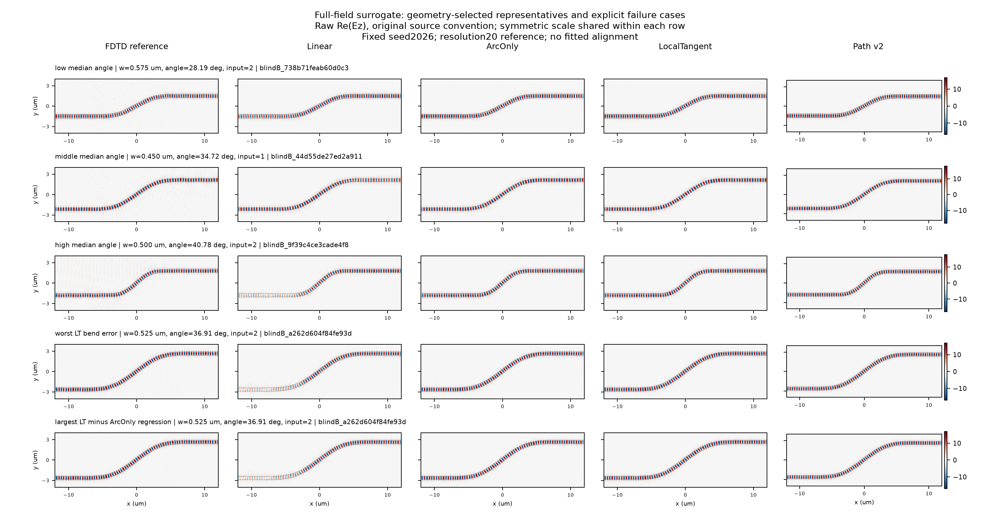
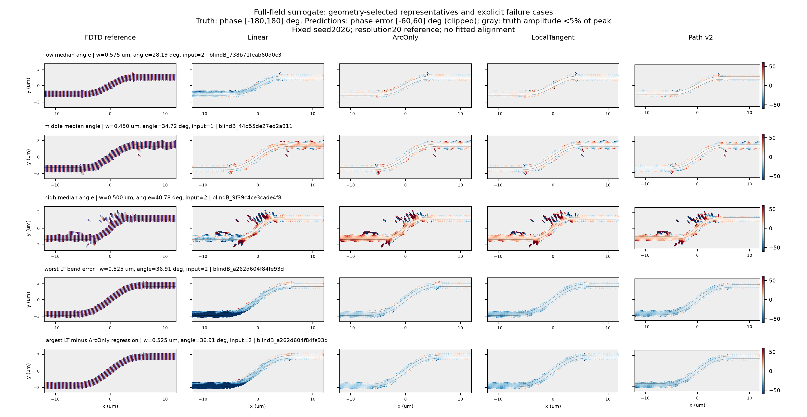
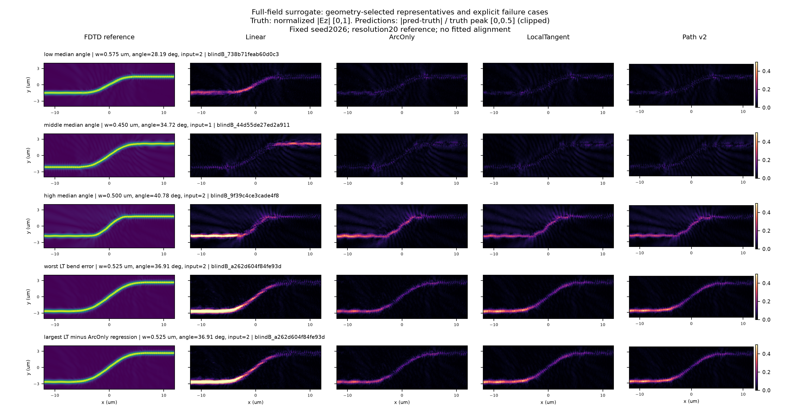
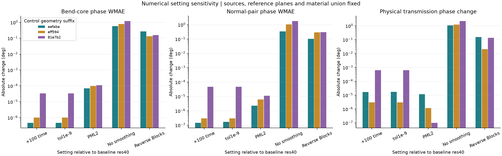
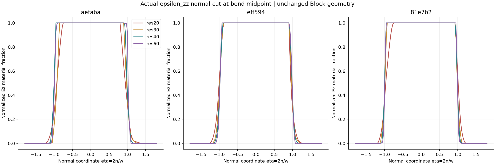
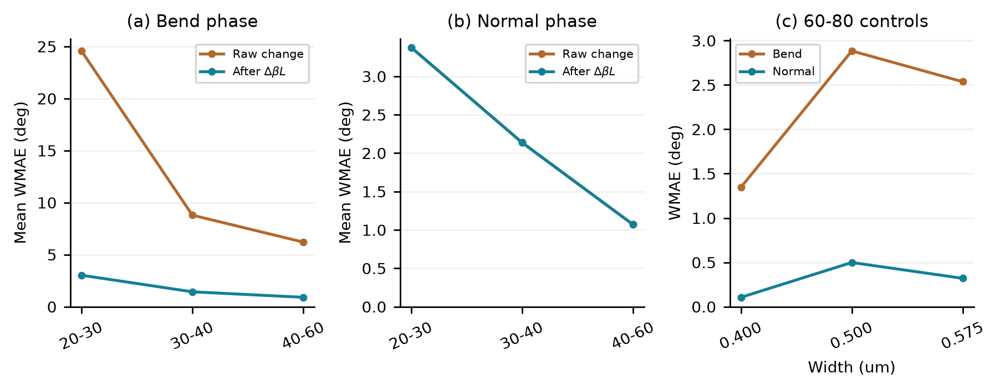
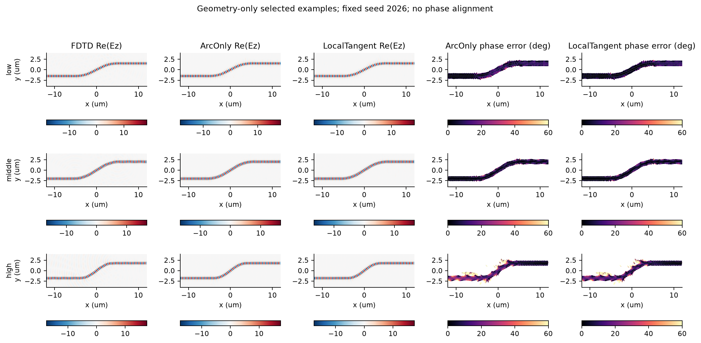

# Supplementary Information

## Geometry-conditioned phase references for predicting FDTD complex fields in optical S-bends

**Revised supplement aligned with manuscript V4.3**  
**Companion to:** *基于几何相位参考的 S 弯波导复电场神经算子预测*  
**Version:** Supplement V4.3 (Markdown editorial revision)

This supplement documents the implementation, reproducibility checks, seed-level results, matched-grid comparisons, numerical-reference diagnostics, and limitations underpinning the main manuscript. **The main manuscript governs the study design and interpretation**; results from the retrospective 100-geometry experiment and exploratory Y-branch study remain explicitly separate from the independent Euler and frozen sinusoidal tests.

We use **L** = Linear, **A** = ArcOnly, **T** = LocalTangent, **P** = Path v2, and, only for the Y-branch experiment, **BP** = Branch Path and **BT** = BranchTangent. All error quantities refer to the **reconstructed physical complex field**, not a freely aligned prediction. Unless noted otherwise, negative differences of the form T − A favor LocalTangent.

**Evidence and availability.** The numerical descriptions and tables in this supplement are transcribed and reorganized from the supplied Supplement V4.2, cross-checked against the supplied manuscript V4.3. The available writing materials describe geometry-level metrics, geometry definitions, and archived experiment summaries; they do not include the original complex-field arrays or model weights for an independent end-to-end rerun. No public deposit of the local S-bend datasets or trained checkpoints is asserted. The main manuscript identifies the public Y-branch sources in references [14, 15].

## S1. Phase representation and geometric implementation

### S1.1. Scope of the phase transformation

The main manuscript, Sec. 2.1, defines \(A=E e^{-i\phi}\), predicts \(\widehat A\), and reconstructs \(\widehat E=\widehat A e^{i\phi}\). The same **unit-modulus carrier** is used for each corresponding target/prediction pair; therefore its complex \(L^2\) and relative-\(L^2\) errors are unchanged by reconstruction. This fact does **not** imply equal learnability or an automatically smoother envelope.

A geometry-conditioned transformation is not a common unitary transformation across all examples. For two geometries,

\[
\langle A_i,A_j\rangle
=\int_\Omega E_i E_j^*\,e^{-i(\phi_i-\phi_j)}\,d\mathbf r.
\tag{S1}
\]

Consequently, the rank of a field-snapshot Gram matrix need not be preserved. For example, on \(x\in[0,2\pi]\), identical snapshots \(E_1=E_2=1\) have rank one. Applying references \(\phi_1=0\) and \(\phi_2=x\) produces orthogonal envelopes of rank two. Reversing the example lowers rank.

The field-gradient identity is given in main Sec. 2.1. An additional useful counterexample is \(E=1,\phi=qx\): demodulation **increases**, rather than decreases, gradient energy from zero to \(q^2\) per unit length. Where derivatives exist on a fixed geometry-parameter domain,

\[
\partial_{q_j}A=e^{-i\phi}\left(\partial_{q_j}E-iE\,\partial_{q_j}\phi\right).
\tag{S2}
\]

These identities permit cancellation of *predictable* phase variation but yield neither a generalization bound nor a universal global smoothness or low-rank claim. At field zeros one uses the product derivative, not division by amplitude; discontinuous routing interfaces require piecewise treatment.

### S1.2. S-bend distance references and Path v2

The simulation and feature generator use the same **256-vertex Euler centerline plus straight leads**, represented by overlapping rotated Blocks. The three principal propagation distances \(d_L,d_A,d_T\) are exactly those in main Eq. (Sec. 2.2). Their distinction is in the output carrier; **ArcOnly does not introduce an additional model input**. The source arclength anchor is obtained from the source projection, and unit tangents from normalized vertex derivatives interpolated at observation columns.

The historical **Path v1** input feature is the signed arclength coordinate of the closest line-segment projection minus the source anchor. Segment parameters are clipped to \([0,1]\); minimum squared-distance ties use the first segment index. Nearest-segment changes can introduce discontinuities outside a unique-projection neighborhood. Path v1 is **not** an additional trained output-reference method in the four-way independent comparison.

For **Path v2**, define \(h=0.05\,\mu\mathrm m\). Straight-lead endpoints are extended by \(10h\); arclength nodes \((\mathbf c_l,s_l)\) have spacing no larger than \(h/4\) and trapezoidal weights \(w_l\). The Gaussian-weighted coordinate is

\[
q(\mathbf r)=
\frac{\sum_l w_l s_l
  \exp[-\lVert \mathbf r-\mathbf c_l\rVert^2/(2h^2)]}
{\sum_l w_l
  \exp[-\lVert \mathbf r-\mathbf c_l\rVert^2/(2h^2)]}.
\tag{S3}
\]

Subtracting the minimum squared distance from all exponents is a numerical stabilization that cancels between numerator and denominator. With \(z=y-y_c(x)\), \(r_0=w/2+h\), \(r_1=r_0+0.5\,\mu\mathrm m\), and \(S(u)=u^3(10-15u+6u^2)\) for \(u\) clipped to \([0,1]\), set

\[
B(z)=1-S\!\left(\frac{|z|-r_0}{r_1-r_0}\right),
\qquad
d_{P2}=\sigma\!\left[
s_c+g\left\{B(q-s_c)+(1-B)t_y z\right\}-s_s
\right].
\tag{S4}
\]

The longitudinal gate \(g\) is the product of one-grid-width quintic transitions at the two bend ends. Kernel evaluation is restricted to the nonzero blend support; outside the gate the distance is columnwise arclength. The parameters were fixed on 16 separate development geometries. The implemented construction is continuous; global \(C^2\) regularity has **not** been established. This definition supplies the \(q\), \(B\), and \(g\) details omitted from the compact expression in main Sec. 2.3.

### S1.3. Calibration, FDTD settings, and common model interface

The propagation slope is extracted from the downstream straight lead: from the bend end plus \(0.75\,\mu\mathrm m\) to \(x=10.5\,\mu\mathrm m\) for left incidence and the mirrored interval for right incidence. Five transverse lines span \([-w/4,w/4]\); at least 20 axial samples and a positive direction-corrected slope are required. Only the **64 training FDTD fields** enter the calibration of the relation reported in main Sec. 2.4,

\[
\beta(\varepsilon_{\max})
=1.1047227348\,\varepsilon_{\max}
+2.5607120654\ \mathrm{rad}/\mu\mathrm m,
\]

with relative RMSE \(0.2085\%\). The common training amplitude scale is **3.8229065364**. Neither scale nor coefficient is refitted to evaluation fields.

The S-bend excitation is a fundamental-band Gaussian eigenmode source with frequency width 0.1 times the center frequency, `NO_PARITY`, and frequency matching. The archived stop rule is `stop_when_dft_decayed(tol=1e-6)`. Source planes are at \(x=\pm11.9\,\mu\mathrm m\); native mode monitors are at \(x=\pm11.5\,\mu\mathrm m\). The source mask follows the actual source-plane voxel convention. The stored source/DFT phase convention is retained.

As stated in main Secs. 2.4 and 3.3, every S-bend model receives the identical 12 real covariates (including all four geometric distance features), packed into seven complex channels before the common exponential wave prior. The models have **1,593,122 parameter tensor elements**, corresponding to **2,944,802 real scalar parameters** when complex components are counted separately. The axial factorized-Fourier blocks use the 40/70 mode setting; this is not a literal rectangular cutoff on the final 2D output. The adaptation was based on the archived NeurOLight code revision `08cad10a78a01e4a522f8b4d287db0b363054e33`. These implementation notes supplement rather than alter the architecture reported in the main manuscript.

## S2. Sampling, chronology, and statistical conventions

### S2.1. Separate evaluation populations

The original S-bend sample consists of **64 training**, **16 validation**, and **100 retrospective test** geometries, one assigned excitation per geometry; the original 180 were generated with NumPy PCG64(2026). The first four of the eight widths contribute 13 original test structures each; the other four contribute 12 each. A further 16 development geometries are excluded from training, validation, and evaluation.

The four reference definitions and all 12 seed/method checkpoints were fixed before building the subsequent **72-geometry independent Euler test**. Its proposal RNG seed is `2026111502`. Among 6,000 candidates, maximum centerline-angle strata are separated at **32.06250418°** and **37.81381195°**, with 24 structures per stratum, three per width per stratum, and 12 left / 12 right excitations per stratum. The selection retains original parameter support, physical-fit conditions, exclusion of known historical geometry records, minimum same-width centerline RMS separation \(0.035\,\mu\mathrm m\), and material-grid duplicate checks. Stratification changes the sampling distribution; the 72 tests are not pooled with the earlier 100.

The independent numerical-reference cohorts comprise 18 Euler geometries at resolution 20/30/40, a **nested three-geometry** subset through resolution 60, a separate nine-case FDTD phase-source diagnostic through resolution 60, and three prescribed **reference-only** resolution-80 controls. The frozen Euler models are also evaluated on **36 sinusoidal** geometries, of which six are selected for resolution 20/30/40 comparisons. These are the overlapping/subset relationships reported in main Table 2, not extra independent training replicates.

### S2.2. Model selection and uncertainty

For each of the seeds **42, 2026, 2027**, the four reference methods share initial weights and a PCG64 minibatch sequence. AdamW runs 2,400 updates, batch size two, initial learning rate 0.002, weight decay \(10^{-4}\), gradient clipping at five, cosine decay to \(10^{-4}\), dropout 0.1, and no spatial augmentation. Validation occurs at update 1 and every 50 updates; the strict minimum validation **physical-field RelL2** chooses the best checkpoint. Final-update checkpoints are used only for a secondary sensitivity comparison. The seed-2026 model is used in galleries and timing, not chosen as the best independent seed.

All metrics are calculated for each geometry before geometry-equal averaging. The five-percent bend-core truth-amplitude gate applies to phase WMAE, **not** to complex RelL2. The primary normal-pair samples at \(\mathbf r_c\pm(w/4)\mathbf n\) use complex bilinear interpolation and true cross-term magnitude weights. The additional pair at the core boundary is a secondary diagnostic, not the primary endpoint. Very small predicted complex amplitudes are assigned the fixed worst-phase penalty. The 1% and 10% gate checks do not establish behavior in general near-zero fields.

With \(\delta=\mathrm{Arg}(\widehat E E^*)\), the pointwise decomposition

\[
|\widehat E-E|^2=
\left(|\widehat E|-|E|\right)^2
+2|\widehat E||E|\,[1-\cos(\delta)]
\tag{S5}
\]

separates a nonnegative amplitude mismatch term from a phase-related term. It is not interchangeable with intensity-weighted phase WMAE. Cross-term RelL2 also contains amplitude information; none of the single-port measurements evaluates coherent two-port driving.

Within each fixed pair of trained models, reported 95% intervals use **10,000 whole-geometry paired bootstrap resamples**. Such intervals are conditional on those fixed models; they do not measure uncertainty over the population of possible training initializations, and no multiplicity adjustment was applied. Three seeds are not 216 independent training trials. The main manuscript reports mean over geometries followed by mean and sample standard deviation over the three seeds.

## S3. Independent Euler S-bend prediction

Tables S1–S2 complement main Table 3 by separating the 12 checkpoints and exposing the whole-field and bend-phase distribution tails. Across all three seeds, ArcOnly makes the largest reduction in mean whole-field error relative to Linear; the LocalTangent increment improves the mean whole-field, bend-core, and primary phase endpoints relative to ArcOnly. Path v2 is close to LocalTangent, with no consistent cross-seed whole-field advantage.

The paired contrasts used to support these statements are reported below. The table also shows a useful limitation: the bend-core **amplitude-only** improvement for seed 2027 has an interval crossing zero; a universal per-metric improvement is not claimed.

| Seed | Ref. | Whole-field RelL2 | Bend-core RelL2 | Bend phase WMAE (°) | Normal-pair phase WMAE (°) | Cross-term RelL2 | Core amplitude RelL2 |
| --- | --- | --- | --- | --- | --- | --- | --- |
| 42 | L | 0.41873 | 0.31536 | 13.55863 | 6.97483 | 0.28081 | 0.15896 |
| 42 | A | 0.16378 | 0.13000 | 5.78980 | 3.99816 | 0.10836 | 0.05317 |
| 42 | T | 0.14204 | 0.09506 | 3.84337 | 3.50362 | 0.09755 | 0.04862 |
| 42 | P | 0.14294 | 0.09573 | 3.80971 | 3.42921 | 0.10165 | 0.05071 |
| 2026 | L | 0.35559 | 0.27974 | 12.80636 | 6.00774 | 0.23157 | 0.12571 |
| 2026 | A | 0.15719 | 0.12087 | 5.24556 | 3.93649 | 0.10598 | 0.05182 |
| 2026 | T | 0.14900 | 0.10273 | 4.26008 | 3.51120 | 0.09982 | 0.04842 |
| 2026 | P | 0.14890 | 0.10228 | 4.22557 | 3.50573 | 0.10012 | 0.04855 |
| 2027 | L | 0.31657 | 0.24507 | 10.93505 | 5.74542 | 0.21125 | 0.11475 |
| 2027 | A | 0.16208 | 0.12628 | 5.56724 | 4.03561 | 0.11008 | 0.05312 |
| 2027 | T | 0.15051 | 0.10621 | 4.45938 | 3.48217 | 0.10287 | 0.05180 |
| 2027 | P | 0.15022 | 0.10571 | 4.43141 | 3.48235 | 0.10300 | 0.05183 |

*Table S1. Independent 72-Euler-geometry evaluation: complete seed-level mean endpoints. The 12 rows are fixed, separately trained method–seed checkpoints; entries are means of 72 geometry-level metrics.*

| Seed | Ref. | Whole median | Whole P90 | Whole max | Core-phase median (°) | Core-phase P90 (°) | Core-phase max (°) |
| --- | --- | --- | --- | --- | --- | --- | --- |
| 42 | L | 0.38983 | 0.61878 | 0.94073 | 11.03320 | 22.39863 | 48.27322 |
| 42 | A | 0.15333 | 0.21501 | 0.30192 | 4.93133 | 10.72168 | 14.17001 |
| 42 | T | 0.13728 | 0.19049 | 0.26440 | 3.42659 | 6.39718 | 8.58262 |
| 42 | P | 0.13806 | 0.18626 | 0.26426 | 3.25718 | 6.17652 | 9.74017 |
| 2026 | L | 0.31021 | 0.61709 | 0.89733 | 9.82582 | 23.61347 | 39.07674 |
| 2026 | A | 0.14198 | 0.21070 | 0.28580 | 4.09150 | 10.41421 | 11.98322 |
| 2026 | T | 0.13737 | 0.21678 | 0.26266 | 3.45713 | 8.65561 | 11.57696 |
| 2026 | P | 0.13633 | 0.21755 | 0.26024 | 3.47984 | 8.62658 | 11.51573 |
| 2027 | L | 0.25397 | 0.49458 | 0.78155 | 8.83941 | 18.71555 | 38.27252 |
| 2027 | A | 0.15331 | 0.22265 | 0.33295 | 4.60712 | 10.39581 | 13.81463 |
| 2027 | T | 0.13713 | 0.21215 | 0.30174 | 3.76243 | 8.16760 | 11.16986 |
| 2027 | P | 0.13615 | 0.21078 | 0.30230 | 3.68692 | 8.22175 | 11.32289 |

*Table S2. Selected distribution summaries for the same fixed 72 geometries. Additional endpoint means appear in Table S1; medians and distribution tails quantify geometry-to-geometry heterogeneity rather than training uncertainty.*

| Endpoint (T − A) | Seed | Mean difference | 95% paired interval | Improved / 72 |
| --- | --- | --- | --- | --- |
| Whole-field RelL2 | 42 | -0.02173 | [-0.02746, -0.01634] | 63/72 |
| Whole-field RelL2 | 2026 | -0.00819 | [-0.01244, -0.00398] | 57/72 |
| Whole-field RelL2 | 2027 | -0.01158 | [-0.01547, -0.00775] | 55/72 |
| Bend-core RelL2 | 42 | -0.03495 | [-0.04387, -0.02622] | 59/72 |
| Bend-core RelL2 | 2026 | -0.01814 | [-0.02517, -0.01133] | 56/72 |
| Bend-core RelL2 | 2027 | -0.02007 | [-0.02635, -0.01400] | 59/72 |
| Bend-core phase (°) | 42 | -1.94643 | [-2.49405, -1.41406] | 58/72 |
| Bend-core phase (°) | 2026 | -0.98548 | [-1.39049, -0.59315] | 56/72 |
| Bend-core phase (°) | 2027 | -1.10786 | [-1.49115, -0.73064] | 55/72 |
| Normal-pair phase (°) | 42 | -0.49454 | [-0.66212, -0.33516] | 57/72 |
| Normal-pair phase (°) | 2026 | -0.42529 | [-0.60148, -0.24904] | 51/72 |
| Normal-pair phase (°) | 2027 | -0.55344 | [-0.72061, -0.39663] | 57/72 |
| Cross-term RelL2 | 42 | -0.01081 | [-0.01423, -0.00755] | 59/72 |
| Cross-term RelL2 | 2026 | -0.00616 | [-0.00950, -0.00286] | 49/72 |
| Cross-term RelL2 | 2027 | -0.00721 | [-0.01113, -0.00339] | 47/72 |
| Core amplitude RelL2 | 42 | -0.00455 | [-0.00590, -0.00336] | 64/72 |
| Core amplitude RelL2 | 2026 | -0.00341 | [-0.00511, -0.00197] | 56/72 |
| Core amplitude RelL2 | 2027 | -0.00132 | [-0.00294, +0.00020] | 45/72 |

*Table S3. All primary independent-Euler paired contrasts. Negative difference favors T; geometry bootstrap intervals condition on fixed trained models.*

| Seed | Low-angle Δ (°) | Middle-angle Δ (°) | High-angle Δ (°) |
| --- | --- | --- | --- |
| 42 | -0.3555 | -0.361 | -0.7671 |
| 2026 | -0.2832 | -0.3314 | -0.6613 |
| 2027 | -0.3515 | -0.3903 | -0.9185 |

*Table S4. Normal-pair phase T − A mean differences in the three maximum-centerline-angle strata (24 Euler geometries per stratum).*

The larger high-angle normal-pair improvement is present in all three seeds (main Fig. 3c), but *absolute bend-phase* differences do not follow a common monotone trend across seeds. Maximum-angle strata are distinct from local spatial-angle masks (absolute local-angle boundaries 0°, 10°, 20°, 35°, 90°) and transverse-position bins (normalized edges −3, −1, −0.5, 0, 0.5, 1, 3). Those spatial maps are descriptive subgroup diagnostics, not a causal mechanism estimate. No multiplicity-adjusted inference was made for these exploratory splits.

## S4. Matched-grid comparisons and numerical-reference diagnostics

### S4.1. Fixed Euler predictions against resolution-20/30/40 FDTD truth

The trained models predict the resolution-20 field, but **the predictions are held fixed** when evaluation truth is changed to resolution 30 or 40. The matched cohort contains 18 prespecified Euler geometries. Higher-grid truth fields are interpolated as **complex fields** onto common physical coordinates, while the normal pairs are sampled at the same physical locations directly in the appropriate reference grid. Geometry IDs and excitation directions are matched. No truth-based per-device phase alignment or amplitude refitting is applied.

The primary reference convention preserves the original source and DFT gauge. In the secondary, physically incident-normalized diagnostic, each truth field is divided by its incoming physical \(E_z\) scalar at the fixed input monitor, and predictions are divided by the resolution-20 input scalar. This is not a fitted correction to the prediction and does not affect the normal-pair relative phase, which cancels any common scalar phase.

For geometry \(g\), training seed \(s\), and truth resolution \(r\), the paired quantity is
\(\Delta_{g,s,r}=e_{T,g,s,r}-e_{A,g,s,r}\).
Each interval uses 10,000 geometry-level paired bootstrap resamples. Intervals are **not** independent repetitions across grid settings.

| Resolution | Seed | A WMAE (°) | T WMAE (°) | T − A (°) | 95% interval (°) | T better |
| --- | --- | --- | --- | --- | --- | --- |
| 20 | 42 | 4.015 | 3.695 | -0.319 | [-0.590, -0.019] | 13/18 |
| 20 | 2026 | 4.035 | 3.794 | -0.241 | [-0.543, +0.078] | 10/18 |
| 20 | 2027 | 4.225 | 3.738 | -0.487 | [-0.826, -0.176] | 16/18 |
| 30 | 42 | 3.252 | 2.796 | -0.456 | [-0.632, -0.287] | 16/18 |
| 30 | 2026 | 3.385 | 2.916 | -0.468 | [-0.726, -0.195] | 14/18 |
| 30 | 2027 | 3.506 | 2.772 | -0.734 | [-1.022, -0.488] | 18/18 |
| 40 | 42 | 2.898 | 2.451 | -0.447 | [-0.708, -0.202] | 15/18 |
| 40 | 2026 | 3.034 | 2.512 | -0.522 | [-0.820, -0.223] | 15/18 |
| 40 | 2027 | 3.236 | 2.395 | -0.841 | [-1.225, -0.553] | 18/18 |

*Table S5. Normal-pair relative phase, matched 18 Euler geometries. Negative mean differences occur throughout; at resolution 20 seed 2026 the interval crosses zero.*

| Resolution | Seed | A bend phase (°) | T bend phase (°) | T − A (°) | 95% interval (°) | T better |
| --- | --- | --- | --- | --- | --- | --- |
| 20 | 42 | 5.193 | 4.031 | -1.162 | [-2.230, -0.123] | 13/18 |
| 20 | 2026 | 4.877 | 4.088 | -0.789 | [-1.696, +0.100] | 14/18 |
| 20 | 2027 | 5.101 | 4.092 | -1.010 | [-1.678, -0.352] | 15/18 |
| 30 | 42 | 26.050 | 25.575 | -0.474 | [-2.342, +1.491] | 12/18 |
| 30 | 2026 | 26.038 | 25.205 | -0.834 | [-2.045, +0.455] | 11/18 |
| 30 | 2027 | 26.941 | 25.580 | -1.362 | [-2.896, +0.058] | 12/18 |
| 40 | 42 | 34.662 | 34.192 | -0.471 | [-2.333, +1.494] | 12/18 |
| 40 | 2026 | 34.651 | 33.820 | -0.830 | [-2.042, +0.459] | 11/18 |
| 40 | 2027 | 35.558 | 34.192 | -1.365 | [-2.901, +0.055] | 12/18 |

*Table S6. Absolute bend-core phase WMAE, exactly the same 18 geometries as Table S5. All finer-grid paired intervals include zero; a stable advantage in this absolute-phase endpoint is not established.*

### S4.2. Nested three-geometry comparison through resolution 60

Three preselected narrow, **left-excited**, \(w=0.400\,\mu\mathrm m\) structures, one from each Euler maximum-angle stratum, have IDs `blindB_26486d65abaefaba`, `blindB_6e088fec4b5d6166`, and `blindB_4b6edc380dbf6922`. They form a subset of the 18 geometries and thus must not be pooled with them as a separate test set. Their 20/30/40 overlap agrees with the matched archived records. The three-geometry bootstrap intervals are discrete and descriptive.

| Res. | Seed | Normal T − A (°) | Normal 95% CI | Bend T − A (°) | Bend 95% CI |
| --- | --- | --- | --- | --- | --- |
| 20 | 42 | -0.620 | [-0.797, -0.510] | -2.195 | [-5.212, +1.207] |
| 20 | 2026 | -0.766 | [-1.191, -0.173] | -2.930 | [-4.102, -0.637] |
| 20 | 2027 | -0.527 | [-0.676, -0.416] | -1.600 | [-3.204, -0.181] |
| 30 | 42 | -0.826 | [-1.026, -0.725] | +6.027 | [+3.367, +7.917] |
| 30 | 2026 | -0.834 | [-1.161, -0.228] | +3.367 | [+0.407, +5.403] |
| 30 | 2027 | -0.508 | [-0.760, -0.223] | +1.506 | [-0.928, +3.575] |
| 40 | 42 | -0.781 | [-1.036, -0.576] | +6.033 | [+3.367, +7.920] |
| 40 | 2026 | -0.824 | [-1.219, -0.162] | +3.371 | [+0.407, +5.407] |
| 40 | 2027 | -0.425 | [-0.655, -0.094] | +1.505 | [-0.932, +3.577] |
| 60 | 42 | -0.789 | [-1.057, -0.577] | +6.033 | [+3.369, +7.921] |
| 60 | 2026 | -0.849 | [-1.199, -0.209] | +3.370 | [+0.408, +5.405] |
| 60 | 2027 | -0.436 | [-0.597, -0.119] | +1.505 | [-0.930, +3.575] |

*Table S7. Paired phase differences for the nested three Euler geometries. All three normal-pair differences remain negative through resolution 60; the *absolute bend-phase mean differences reverse sign* at resolutions 30/40/60.*

Table S7 is an important **adverse result**. In this restricted subset, LocalTangent retains a normal-pair phase advantage while its absolute bend-phase endpoint becomes worse at the finer grids. This is possible because the normal-pair relative phase rejects a shared longitudinal phase offset. The result prevents extrapolating the normal-phase advantage into universal cross-grid absolute-phase or full-field accuracy.

### S4.3. Changes in the FDTD truth itself

The following quantities compare **numerical reference fields with each other**, not model errors or rigorous continuum-error bounds. The absolute bend-phase comparison here uses incident normalization as specified above.

| Grid pair | Geometries | Truth observable | Mean change (°) | Maximum (°) |
| --- | --- | --- | --- | --- |
| 20 → 30 | 18 | Normal-pair phase | 3.369 | 8.224 |
| 20 → 30 | 18 | Incident-normalized bend phase | 25.029 | 31.708 |
| 30 → 40 | 18 | Normal-pair phase | 1.7 | 4.935 |
| 30 → 40 | 18 | Incident-normalized bend phase | 8.81 | 12.385 |
| 40 → 60 | 3 | Normal-pair phase | 0.377 | 0.539 |
| 40 → 60 | 3 | Incident-normalized bend phase | 4.245 | 4.902 |

*Table S8. Matching-grid sensitivity of the Euler FDTD reference. The 40→60 values use only the nested three structures.*

The resolution-30→40 mean changes of **1.700°** (normal-pair phase) and **8.810°** (incident-normalized bend phase) exceed what would justify treating resolution-40 fields as a converged physical ground truth. In the archived analysis, an application-readiness decision gate was therefore not met; no coherent two-port or reverse-direction application was validated by these comparisons. Bilinear-versus-cubic interpolation changed resolution-40 normal-phase results by about **0.00411°** on average, much smaller than the measured truth-grid variation.

### S4.4. Propagation-phase and solver-source diagnostics

Nine previously evaluated Euler structures span three widths, angle strata and both incidence directions through resolution 60. In this diagnostic design, the narrow structures are left-excited and the medium/wide ones right-excited; width and direction are **confounded**. Three separately prescribed controls reach resolution 80, but are **reference-only**: there are no resolution-80 model-error comparisons.

The FDTD propagation constant is extracted from the longitudinal slope of a projected guided-mode \(E/H\) coefficient over \(x\in[-9,9]\,\mu\mathrm m\), with alternate-window controls. A direct centerline slope, MPB mode solutions, and a continuous symmetric-slab TE0 calculation provide independent numerical references. MPB wavevectors in cycles/\(\mu\mathrm m\) are multiplied by \(2\pi\). Different discretizations need not agree exactly. A straight-waveguide reference matched in width, source height, and direction supplies the diagnostic phase change \(\Delta\beta L\); the latter is **not** applied to correct model predictions.

| Width (µm) | Res. | FDTD β | MPB β | MPB high-res β | Slab β |
| --- | --- | --- | --- | --- | --- |
| 0.400 | 20 | 7.502666 | 7.451212 | 7.446078 | 7.468512 |
| 0.400 | 30 | 7.483554 | 7.464794 | 7.461740 | 7.468512 |
| 0.400 | 40 | 7.476946 | 7.470284 | 7.468138 | 7.468512 |
| 0.400 | 60 | 7.472252 | 7.474867 | 7.473536 | 7.468512 |
| 0.500 | 20 | 8.901254 | 8.806453 | 8.800457 | 8.839811 |
| 0.500 | 30 | 8.875424 | 8.821641 | 8.814941 | 8.839811 |
| 0.500 | 40 | 8.854898 | 8.828722 | 8.826254 | 8.839811 |
| 0.500 | 60 | 8.846494 | 8.834001 | 8.832476 | 8.839811 |
| 0.575 | 20 | 9.444900 | 9.324317 | 9.330319 | 9.363361 |
| 0.575 | 30 | 9.401211 | 9.342606 | 9.341682 | 9.363361 |
| 0.575 | 40 | 9.386221 | 9.352048 | 9.348034 | 9.363361 |
| 0.575 | 60 | 9.372067 | 9.353965 | 9.355618 | 9.363361 |

*Table S9. Centered straight-waveguide longitudinal propagation constants (rad/µm). Direct centerline slopes in the archived table differed from FDTD projected slopes only in the last few decimal places.*

| Grid pair | n | Bend phase change (°) | After ΔβL (°) | Normal phase change (°) | Normal residual (°) |
| --- | --- | --- | --- | --- | --- |
| 20 → 30 | 9 | 24.57321 | 3.02399 | 3.37608 | 3.37605 |
| 30 → 40 | 9 | 8.79492 | 1.43019 | 2.13738 | 2.13738 |
| 40 → 60 | 9 | 6.20681 | 0.90322 | 1.07085 | 1.07084 |

*Table S10. Nine-case matched-grid phase changes and explanatory propagation-reference residuals. Removing ΔβL from the **diagnostic** suppresses much of the common bend-phase shift but not the normal-pair relative phase.*

The \(\Delta\beta L\) residual is not a pure curvature error or an additive variance decomposition. Geometry voxelization, finite time step, local mode mismatch, interpolation and material averaging may interact. A matching straight-port normalization reduces the nine-case 30→40 *absolute circular port phase change* from **17.7146°** to **1.7701°**; this is explanatory, not a surrogate output correction.

The numerical material diagnosis samples the \(E_z\)-specific permittivity through the inverse of `fields.get_inveps(Ez,Z,point)`, not an averaged scalar trace. The analytic overlapping-Block union and discretized material are sampled on 129 fixed normal cuts and 145 normalized transverse positions over \([-1.8,1.8]\). Reversing same-material curved Blocks preserves the continuum union but can alter the sampled voxel field. Neither that reversal nor disabling material averaging certifies a better continuum geometry.

| Resolution-40 control | Bend mean / max (°) | Normal mean / max (°) | Max port phase (°) |
| --- | --- | --- | --- |
| Cold baseline replay | 0 / 0 | 0 / 0 | 0 |
| Extra 100-step continuation | 0.000012 / 0.000034 | 0.000016 / 0.000046 | 0.000629 |
| Independent strict DFT stop | 0.000012 / 0.000034 | 0.000016 / 0.000046 | 0.000629 |
| PML doubled | 0.000093 / 0.000110 | 0.000007 / 0.000011 | 0.000012 |
| No permittivity averaging | 0.862649 / 1.211264 | 1.060177 / 1.794404 | 2.213974 |
| Reordered curved Blocks | 0.187019 / 0.268202 | 0.230090 / 0.299075 | 0.155243 |

*Table S11. Prescribed numerical setting sensitivities for three resolution-40 controls, in degrees. The strict-stop comparison used independent tolerance-1e-9 runs with absolute minimum/maximum times 400/800.*

| Width (µm) | β at Courant 0.5 | β at 0.25 | Accumulated phase over 23 µm (°) |
| --- | --- | --- | --- |
| 0.4 | 7.4769461 | 7.4776386 | 0.91256 |
| 0.5 | 8.8548979 | 8.8557059 | 1.06479 |
| 0.575 | 9.3862214 | 9.3870623 | 1.10817 |

*Table S12. Resolution-40 Courant-factor sensitivity. Propagation constants are rad/µm.*

| Reference-only control | Width (µm) | 60→80 bend change (°) | 60→80 normal change (°) |
| --- | --- | --- | --- |
| …26486d65abaefaba | 0.4 | 1.34581 | 0.10559 |
| …cce44732dceff594 | 0.5 | 2.88367 | 0.49831 |
| …9f78121d6c81e7b2 | 0.575 | 2.53673 | 0.31999 |

*Table S13. Three prescribed resolution-60→80 FDTD reference comparisons; no neural-model prediction was evaluated at resolution 80.*

Longer duration and the tested PML change produce much smaller differences than material representation changes in these controls, but the effect need not generalize to every structure. PML thickness increased from 1 to 2 µm by expanding the simulation cell from \(26\times10\) to \(28\times12\,\mu\mathrm m\) while preserving the non-PML region and source/monitor positions. A time cap is not a convergence certificate. No straight-waveguide resolution-80 reference was generated, so no 60→80 \(\Delta\beta L\) attribution is claimed. These tests do not establish continuum convergence.

## S5. Deployment and computational accounting

### S5.1. Workflow boundary and observed timings

The geometry-only deployment accepts the supported geometry parameters and excitation, the selected reference method and trained seed, and the output location. It initializes the material grid **without time-domain propagation**, creates the identical common geometric inputs and carrier, runs the frozen neural model, reconstructs \(E_z\), and exports the prediction. The archived replay of all 72 independent geometries reproduced the prepared inputs, carriers, and saved model outputs bitwise. Replay tests implementation consistency, not the physical validity of the predictions.

The comparison is **end-to-end wall time** on the specified heterogeneous hardware: Intel Core Ultra 7 356H CPU, RTX 5070 Laptop GPU (approximately 12 GB), WSL Ubuntu 24.04, Meep 1.35.1, PyTorch 2.11.0, CUDA 12.8. FDTD uses its recorded two-thread CPU workflow; inference uses four Torch threads and synchronized GPU measurements. FDTD also exports \(H_x,H_y\), modal coefficients, and audits not reproduced by the surrogate \(E_z\) export; the timings do not represent a matched-accuracy, equal-output solver speedup.

The archived **FDTD mean is 8.892146 s per structure**. Cold calls include process start/model loading; resident and 72-geometry batch calls charge session initialization separately. A batch size of 2 in the inference stage does not imply omission of geometric preparation or output export.

| Reference | Cold (s/query) | Resident (s/query) | 72-query batch, size 2 (s/query) | Session cost (s) |
| --- | --- | --- | --- | --- |
| Linear | 4.7069 | 2.6128 | 1.5941 | 0.8670 |
| ArcOnly | 4.6891 | 2.4780 | 1.5953 | 0.3076 |
| LocalTangent | 4.7251 | 2.4540 | 1.5913 | 0.3013 |
| Path v2 | 4.5837 | 2.4330 | 1.5897 | 0.3217 |

*Table S14. Full-workflow timings for seed-2026 checkpoints. Session cost is charged once to resident/batch scenarios and is not silently folded into each displayed query average.*

For the LocalTangent batch mode, the complete query time is **1.5913 s/geometry**, a workflow-time ratio of approximately **5.59** relative to the archived FDTD workflow (main Table 7). Shared material initialization, all common geometric features, and input export cost **0.22152**, **1.14222**, and **0.12570** s respectively on average. The full 12-feature preparation includes the four geometric features even for simpler output references. Most of the remaining optimization opportunity lies in **shared preprocessing**, not in swapping among the four carrier formulas.

The existing safety smoke test adds approximately **0.00673 s** and was introduced after the archived timing comparison; this retrospective overhead is identified explicitly rather than inserted into historical records.

### S5.2. Offline reconstruction and break-even sensitivity

For a **single LocalTangent seed-2026 model**, the following offline reconstruction matches main Table 6. The unrecorded work is a **replay-based estimate** rather than a measured historical duration.

| Offline component | Seconds | Evidence status |
| --- | --- | --- |
| 64 training + 16 validation FDTD labels | 798.360 | Historical recorded |
| 80 common feature computations | 97.876 | Historical recorded |
| LocalTangent training (incl. validation/checkpoints) | 650.232 | Historical recorded |
| Recorded subtotal | 1546.468 | Incomplete original timers |
| Previously unrecorded setup/calibration/cache work | 19.709 | Replay estimate |
| Reconstructed total | 1566.177 | Estimate, not exact historical project cost |

*Table S15. Single-model LocalTangent offline cost. Exploratory multiple-model training, evaluation labels, and FDTD diagnostics are **research costs**, not prerequisites counted in one deployed checkpoint.*

| Query mode | Recorded lower-bound break-even | Reconstructed break-even | Assumed +60 s | Assumed +300 s |
| --- | --- | --- | --- | --- |
| Cold, one query | 372 | 376 | 386 | 444 |
| Resident, one query | 241 | 244 | 250 | 287 |
| 72-query batch, size 2 | 212 | 215 | 221 | 253 |

*Table S16. Integer-query break-even sensitivity for LocalTangent under the archived linear per-query accounting. The +60/+300 s rows are scenarios, not measured overhead; for complete batches of 72, the reconstructed batch break-even rounds from 215 to 216 actual queries.*

The break-even expression is given in main Sec. 5.3. A user-level cost advantage depends on an acceptable prediction error and sufficient repeated queries. The ex post whole-field RelL2 thresholds **0.10, 0.15, 0.20** in main Fig. 4(c) are descriptive pass rates on the same 72 truth fields; no prospective online error detector, truth-dependent filtering rule, or free automatic FDTD fallback is validated. Neither energy use nor financial cost was measured.

## S6. Field and solver-control visualizations

Representative real-field and phase/error galleries retain the original five-row selection convention: three geometry-stratum representatives closest to the median maximum angle (ID tie-breaking) and the declared adverse case. The worst LocalTangent bend-core phase and the largest T − A regression refer to the same structure in the archived selection; **that geometry is represented once in interpretation**, not counted as two independent failures. All quantitative conclusions still use all 72 structures. Gallery seed 2026 is fixed for presentation, not selected for performance.

The following images are copied byte-for-byte from the supplied writing-package figures, without recomputation or alteration of numerical content. Their filenames correspond to their revised figure labels.

*Figure S1. Numerical and predicted real parts of \(E_z\) for the geometry-based Euler gallery, including the selected adverse case. Shared field scaling and geometry outlines follow the archived panel.*

*Figure S2. Euler wrapped phase-error gallery, retaining the separate truth-phase scale and the archive's display-only low-amplitude mask. Quantitative metrics are evaluated using the prescribed bend-core gate rather than this visualization mask.*

*Figure S3. Absolute complex-field error on the same Euler selection and common display scale. Evaluation integrates the prescribed complete region, not only plotted bright pixels.*

*Figure S4. FDTD setting controls for duration, PML, material averaging, and Block order. The quantitative controls and interpretation are in Sec. S4.4 and Table S11.*

*Figure S5. Component-specific effective-permittivity profiles on fixed physical normal coordinates for selected numerical grids. These profiles are discretization diagnostics, not exact continuum interface measurements.*

*Figure S6. Nine-case FDTD propagation-phase diagnostics and three reference-only 60→80 controls. No prediction at resolution 80 or truth-aligned model correction is implied.*

## S7. Frozen transfer from Euler to sinusoidal S-bends

### S7.1. Geometry, no-retraining protocol, and seed-level endpoints

The **raised-sine** centerline is defined in **main Sec. 3.2**, not Sec. 4.4. It is not the raised-cosine SBend profile in PICwriter. Its continuous endpoint slope and curvature vanish, while the 256-vertex polyline/Block discretization has its own material-grid error.

The 36 structures cover actual endpoint offsets **1.965–5.213 µm**, axial spans **6.887–14.822 µm**, and analytic minimum radii **3.912–9.012 µm**. The maximum-angle stratum boundaries are **30.1934°** and **34.3810°**. Six widths (0.400, 0.425, 0.475, 0.500, 0.550, 0.575 µm) and both incidence directions give 12 geometries per stratum. Selection matches Euler structures by **actual** endpoint span and offset rather than nominal geometry-constructor inputs. Arclength, curvature, peak angle and optical difficulty are not matched.

Only the geometry-to-centerline interface changes: materials, common inputs, reference algorithms, training-only propagation/amplitude calibration, and **all 12 Euler-trained checkpoints are frozen**. Prediction files were fixed before generating new FDTD truth fields. All 36 material grids are distinct from 252 archived fields and mirrored checks. The transfer adds 36 resolution-20 truth fields plus 12 fine-grid truth fields for six selected geometries; it introduces **no additional model selection or training**.

| Seed | Ref. | Whole RelL2 | Core RelL2 | Core-phase WMAE (°) | Normal-phase WMAE (°) | Cross-term RelL2 |
| --- | --- | --- | --- | --- | --- | --- |
| 42 | L | 0.37167 | 0.28835 | 12.09202 | 6.46632 | 0.26887 |
| 42 | A | 0.15998 | 0.12743 | 5.60778 | 4.40261 | 0.11451 |
| 42 | T | 0.14175 | 0.09569 | 3.82480 | 3.79261 | 0.10439 |
| 42 | P | 0.14200 | 0.09572 | 3.75813 | 3.73049 | 0.10721 |
| 2026 | L | 0.30946 | 0.24426 | 10.51974 | 5.45007 | 0.22490 |
| 2026 | A | 0.15368 | 0.11811 | 5.01553 | 4.30064 | 0.11430 |
| 2026 | T | 0.14011 | 0.09505 | 3.73704 | 3.83824 | 0.10570 |
| 2026 | P | 0.13979 | 0.09424 | 3.68233 | 3.81642 | 0.10580 |
| 2027 | L | 0.27905 | 0.21029 | 8.99820 | 5.20259 | 0.19569 |
| 2027 | A | 0.15991 | 0.12319 | 5.37324 | 4.49477 | 0.11783 |
| 2027 | T | 0.14579 | 0.10232 | 4.13377 | 3.72436 | 0.11021 |
| 2027 | P | 0.14590 | 0.10240 | 4.13360 | 3.71957 | 0.11035 |

*Table S17. Complete means for the 36 sinusoidal structures, using Euler-trained checkpoints without retraining or truth alignment.*

| Metric (T − A) | Seed | Difference (°) | 95% paired interval (°) | Improved / 36 |
| --- | --- | --- | --- | --- |
| Bend-core phase (°) | 42 | -1.78298 | [-2.46619, -1.09025] | 26/36 |
| Normal-pair phase (°) | 42 | -0.61000 | [-0.83268, -0.39061] | 31/36 |
| Bend-core phase (°) | 2026 | -1.27849 | [-1.80400, -0.76255] | 28/36 |
| Normal-pair phase (°) | 2026 | -0.46241 | [-0.68227, -0.24771] | 27/36 |
| Bend-core phase (°) | 2027 | -1.23947 | [-1.75454, -0.77799] | 29/36 |
| Normal-pair phase (°) | 2027 | -0.77040 | [-1.00913, -0.54402] | 32/36 |

*Table S18. Primary sinusoidal local-phase comparisons. All six conditional geometry-paired intervals are negative; they do not imply every structure improves.*

The three-seed mean whole-field RelL2 values in the frozen transfer are **0.3201, 0.1579, 0.1426, 0.1426** for Linear, ArcOnly, LocalTangent, and Path v2 respectively (main Table 5). The local-phase comparisons support a transfer of the *relative* local-tangent benefit across this second class of smooth single-path centerlines, not a claim of broad topology-general performance.

### S7.2. Sinusoidal mesh sensitivity and limits

Six preselected sinusoidal structures span the three angle/width levels and both incidence directions. The six-device subset has width–angle confounding; the fixed predictions and source/reference planes are unchanged as truth-grid resolution changes among **20, 30 and 40**. From resolution 30 to 40, the *truth-reference* changes average **1.979°** for normal-pair phase and **8.937°** for incident-normalized bend-core phase. The bilinear-versus-cubic sensitivity of the resolution-40 normal-pair metric is approximately **0.004°** on average.

For each seed and tested truth grid, the mean **normal-pair T − A phase** remains negative. All six intervals at resolutions 30 and 40 exclude zero on the negative side. However, on these finer grids the **absolute bend-phase mean differences reverse sign**, with all six intervals including zero. These statements report the archived signed-comparison conclusions; they are not a substitute for a continuum convergence study. The original V4.2 supplement refers to a companion file named `sine_mesh_primary_table.csv` for the full numerical values. **That CSV was not among the two uploaded source documents**, so its unquoted entries have not been reconstructed or invented here. The full signed fine-grid table should be attached if it is available at submission.

*Figure S7. Geometry-selected sinusoidal examples for the fixed seed-2026 model. Columns compare reference, ArcOnly and LocalTangent real fields and their wrapped phase errors. The three examples are selected by median peak angle within strata, not by model error. Display phase errors are limited to 0–60° for visualization; quantitative evaluation uses the stated phase gate.*

The transfer does not establish an optical-control application, power-normalized transmission improvement, cross-architecture generalization, or Euler timing/cost amortization on sinusoidal geometries.

## S8. Retrospective and exploratory analyses

The following material is intentionally distinct from the frozen **72-Euler** and **36-sinusoidal** evaluations. It supports the chronology, downstream-use limitations, and topology/mechanism boundaries of the main manuscript; it is not pooled with the primary independent cohorts.

### S8.1. Original 100-geometry Euler benchmark and checkpoint sensitivity

The original 100-geometry benchmark (50 left, 50 right excitation) was inspected **before** the four-method/three-seed comparison was fully fixed. It is therefore **retrospective**. The result ordering in main Sec. 4.1 is reproduced in the validation-selected (best) checkpoints below, with a last-update sensitivity shown side by side. All columns are unaligned **whole-field complex RelL2**, averaged over the same 100 structures.

| Seed | L best | L last | A best | A last | T best | T last | P best | P last |
| --- | --- | --- | --- | --- | --- | --- | --- | --- |
| 42 | 0.400205 | 0.399805 | 0.166673 | 0.167372 | 0.148650 | 0.148358 | 0.149312 | 0.147960 |
| 2026 | 0.337387 | 0.337387 | 0.161969 | 0.162054 | 0.153715 | 0.152596 | 0.153420 | 0.152286 |
| 2027 | 0.300163 | 0.303942 | 0.166983 | 0.166983 | 0.154842 | 0.154742 | 0.154553 | 0.154477 |

*Table S19. Original 100-Euler retrospective benchmark. Best = minimum validation RelL2 checkpoint; last = end of 2,400 updates. This table replaces numerous overlapping historical checkpoint and pair-comparison tables.*

For the retrospective best checkpoints, the three-seed mean whole-field RelL2 values are **0.3459**, **0.1652**, **0.1524**, and **0.1524** for L/A/T/P, as reported in main Sec. 4.1. This analysis does not make the original 100 retrospectively independent. Archived within-seed paired contrasts favor ArcOnly over Linear and LocalTangent over ArcOnly, but near-tied T/P ordering is training-seed dependent.

The earlier seed-2026 five-reference development comparison included **Direct** (best 0.848248), **Path v1** (best 0.153654), and the then-existing L/T/P checkpoints; Direct and Path v1 were **not** retrained as extra methods across the independent 12-checkpoint design. The historical port-stratified and core/halo/far results were descriptive. Their region-specific RelL2 values are normalized by different region truth energies, so they cannot be added to obtain full-field error or treated as additive error contributions.

### S8.2. Optical postprocessing: method, transmission phase, and reflection limitations

The postprocessing analysis of main Sec. 4.5 uses the **original 100-Euler benchmark**, not the later 72 independent structures. At each port, the occupied source/port mask defines the observation column; the transverse interval is padded by ten pixels. A fixed scalar finite-difference eigenproblem uses diagonal \(k_0^2\varepsilon-2/h^2\), off-diagonal \(1/h^2\), and homogeneous Dirichlet boundaries. The leading eigenvalue defines \(\beta_p^2\); the real eigenvector uses a positive-sum gauge and \(h\sum_j u_j^2=1\).

With a centered axial derivative and discrete transverse overlap, the approximate directional amplitudes are

\[
a_\pm=\frac12\left(
\langle u,E_z\rangle\ \pm\
\frac{\langle u,\partial_x E_z\rangle}{i\beta_p}
\right).
\tag{S6}
\]

The output direction is negative \(x\) at the left port and positive \(x\) at the right port; the incident direction is opposite. Each amplitude is multiplied by \(\sqrt{\beta_p}\) and normalized by **its own field's** extracted incident amplitude. No true-field incident denominator is substituted for a prediction. The native Meep directional slots in this archive are 0 for \(+x\) and 1 for \(-x\). Source and monitor reference planes are not de-embedded to a common plane.

This is an **\(E_z\)-only scalar proxy**, not the native \(E/H\) modal decomposition. With \(t_N\) the native true coefficient, \(t_P\) the same proxy applied to the true field, and \(\widehat t_P\) the proxy applied to the prediction,

\[
\widehat t_P-t_N
=(\widehat t_P-t_P)+(t_P-t_N).
\tag{S7}
\]

The complex difference decomposes algebraically; magnitudes, power errors and circular phase errors **do not** add. Model discrepancy is \(\widehat t_P-t_P\), extractor discrepancy is \(t_P-t_N\), and total discrepancy is \(\widehat t_P-t_N\).

| Reference | Transmission complex MAE | Transmission phase MAE (°) | Power MAE | IL MAE (dB) |
| --- | --- | --- | --- | --- |
| Linear | 0.526657 | 28.6596 | 0.460689 | 3.433245 |
| ArcOnly | 0.154856 | 8.4987 | 0.069917 | 0.318398 |
| LocalTangent | 0.137903 | 7.3614 | 0.075106 | 0.334560 |
| Path v2 | 0.139338 | 7.4085 | 0.079125 | 0.357770 |

*Table S20. Three-seed mean *model* discrepancies against the true-field scalar proxy on 100 original Euler geometries. The fixed proxy-versus-native extractor discrepancy is common to all methods: complex MAE 0.000835, phase MAE 0.0271°, power MAE 0.001175, and insertion-loss MAE 0.005244 dB.*

Main Sec. 4.5 rounds the four transmission phase errors to **28.66°, 8.50°, 7.36°, and 7.41°**. The ordering of power MAE is different: ArcOnly's **0.069917** is lower than LocalTangent's **0.075106** in this proxy-target comparison. All 100 transmission channels pass the archived native-amplitude \(|t_N|\ge0.05\) gate, whereas only 16 reflection channels do.

A centered finite difference applied to an ideal forward exponential replaces \(i\beta\) by \(i\sin(\beta h)/h\). This gives a spurious backward/forward scalar amplitude ratio

\[
r_{\mathrm{FD}}
=\frac{1-\sin(\beta h)/(\beta h)}
{1+\sin(\beta h)/(\beta h)}.
\tag{S8}
\]

It is a discretization floor, not a fitted correction. Averaged over methods, the fixed true-field reflection extractor differs from native labels by **complex MAE 0.023406**, **power MAE 0.000870**, and **gated reflection-phase MAE 21.159°**. For comparison, the best-checkpoint model-to-proxy reflection complex MAE values are about **0.0307–0.0323**, and gated reflection phase MAE values about **104.8–128.7°** across the four references. These results do **not** establish calibrated weak-reflection prediction or engineering-grade return-loss estimation.

The native **test** transmission power \(T\) has minimum/median/maximum **0.933612 / 0.981865 / 0.994677**; reflection power \(R\) has **0.000014 / 0.000858 / 0.005787**. Those are descriptive ranges of the original dataset. With the retained normalization and nearby source/monitor reference planes, \(1-T-R\) is **not certified as pure radiation loss**, nor is a better full-field RelL2 guaranteed to improve every extracted optical observable.

### S8.3. Exploratory Y-branch topology boundary

The exploratory Y-branch comparison underlying main Sec. 4.6 uses **one seed (2026)** and two disjoint geometry sets, **E2 and M4**, with 100 geometries each. It is not a three-seed, topology-independent replication. A single trained model per Y-branch method is reused across both sets. The 64 training structures have port-source counts 17/20/27 and the validation set contains eight. The matched 2,400-update schedules are compared; earlier 1,200-update experiments used different schedules and are not one continuous trajectory.

The historical Y-branch geometry feature estimates upper/lower centerlines from material columns, smooths by a three-pixel Gaussian, marks the junction when their separation first exceeds 1.5 pixels, and assigns each pixel to a branch by the centerline midpoint. It may create an artificial branch seam. The route distance is expressed in **pixels**, calibrated with **rad/pixel** (no additional physical-size multiplication). For trunk incidence, the distance grows along the chosen route; for branch incidence, it reverses on the incoming route and follows the other outgoing arm with the junction-anchored signed expression described in the historical implementation. BranchTangent adds the local transverse correction
\(u-u_s\), where
\(u=q_b t_{b,y}(y-y_b)\),
\(t_{b,y}=y_b'/\sqrt{1+(y_b')^2}\), and \(q_b\) is the route-derivative sign.
The correction's source value is interpolated at the historical mask centroid, without newly introduced seam smoothing.

| 100-geometry set | Reference | Best mean RelL2 | Last mean RelL2 |
| --- | --- | --- | --- |
| E2 | Linear | 0.617460 | 0.619861 |
| E2 | Branch Path | 0.533341 | 0.535476 |
| E2 | BranchTangent | 0.549394 | 0.552136 |
| M4 | Linear | 0.581503 | 0.582089 |
| M4 | Branch Path | 0.495988 | 0.498927 |
| M4 | BranchTangent | 0.511072 | 0.514325 |

*Table S21. Single-seed exploratory Y-branch comparisons. BranchTangent is worse than Branch Path in both disjoint evaluation sets for best and last checkpoints.*

The best-checkpoint BranchTangent-minus-Branch Path increments are **+0.016053** on E2 and **+0.015084** on M4, using the displayed source means before rounding. Port-stratified archived increases are also positive; however, they are unadjusted for baseline difficulty and not causal evidence of which junction mechanism causes the loss. E2/M4 agreement does not create independent training-seed replication.

Previously tested Half/Reversed/Shuffled branch-routing interventions change the **route**, not specifically the new local-tangent term. They are therefore excluded from the revised comparative tables and must not be presented as matched evidence for or against the tangent increment. The topology experiment supports only the limitation that a hard-assignment, routed Y-branch carrier did **not** inherit the S-bend LocalTangent improvement.

### S8.4. Fourier and learning-mechanism counterexamples

The exploratory full-domain Fourier diagnostic uses the **64 S-bend training fields**, a common amplitude scale, and fixed carriers. Periodic rectangular-grid reconstruction tails are measured on the \(24\times8\,\mu\mathrm m\) output domain; they are **not** the precise factorized-neural-operator approximation space. Tail energy fractions are normalized per geometry before averaging. Nonperiodic boundary traces can also invalidate naive continuous periodic Sobolev interpretations.

| Carrier | Rectangular modes My/Mx | Tail energy (%) | Fourier reconstruction mean RelL2 |
| --- | --- | --- | --- |
| Direct | 10/18 | 99.299092 | 0.996482 |
| Linear | 10/18 | 5.779094 | 0.238506 |
| LocalTangent | 10/18 | 2.945975 | 0.171347 |
| Path v1 | 10/18 | 2.925593 | 0.170767 |
| Path v2 | 10/18 | 2.942759 | 0.171255 |
| Direct | 20/35 | 28.541481 | 0.455510 |
| Linear | 20/35 | 0.585342 | 0.075811 |
| LocalTangent | 20/35 | 0.592326 | 0.076262 |
| Path v1 | 20/35 | 0.587296 | 0.075937 |
| Path v2 | 20/35 | 0.592327 | 0.076262 |
| Direct | 40/70 | 0.122264 | 0.034951 |
| Linear | 40/70 | 0.097819 | 0.031116 |
| LocalTangent | 40/70 | 0.101107 | 0.031663 |
| Path v1 | 40/70 | 0.104188 | 0.032157 |
| Path v2 | 40/70 | 0.101079 | 0.031659 |

*Table S22. Selected archived whole-domain spectrum endpoints. A finer 60/105 block was omitted for concision; the main text's counterexample does not require all four rectangular cutoffs.*

Removing the dominant propagation carrier dramatically reduces low-mode tail energy relative to Direct, but **LocalTangent does not strictly dominate Linear at every cutoff** (for example 20/35 and 40/70). Accordingly, the full-field neural prediction advantage must not be attributed to a uniformly smaller global Fourier tail or guaranteed smoother envelope.

A separate **historical Y-branch** projection diagnostic compares Branch Path against Linear, **not** BranchTangent against Branch Path: centerline phase-gradient RMS falls from **0.805715** to **0.557936 rad/µm**, yet non-seam two-dimensional gradient energy rises from **9.453972** to **16.662520 µm⁻²**, and rank-eight training-formed POD oracle projection RelL2 rises from **0.492985** to **0.534896**. Because the POD projection uses the *true query field*, it is an oracle approximation and not a prediction method. These measurements further reject universal smoothness/low-rank mechanisms.

An older 123,330-parameter U-Net study used only 32 training geometries, 600 updates, one seed, and Direct/Linear/Path outputs; it neither matched the present architecture and budget nor compared the new LocalTangent increment. No cross-architecture replication, data-efficiency law, or longer-budget convergence result is inferred from that study.

## S9. Interpretation boundary and correspondence with the main article

The principal evidence hierarchy is: **72 independent Euler geometries** (main Secs. 4.1–4.2; Tables S1–S4), **36 frozen sinusoidal tests** (main Sec. 4.3; Tables S17–S18), **matched numerical-reference sensitivities** (main Sec. 4.4; Tables S5–S13), and **complete-workflow timing** (main Sec. 5; Tables S14–S16). The retrospective and exploratory analyses in Sec. S8 bound these claims, not strengthen them through pooling.

The method demonstrates a useful geometry-derived phase representation **for the evaluated single-path S-bends**. It does not demonstrate cross-topology improvement, numerical continuum convergence, consistently lower error in every downstream optical observable, or a speedup relative to an equal-accuracy and equal-output FDTD solver. The revised citations to the main manuscript refer to its actual **V4.3** numbering (main Figs. 1–4 and Secs. 2–6); no stale reference to a field gallery as “main Figure 4” remains.
